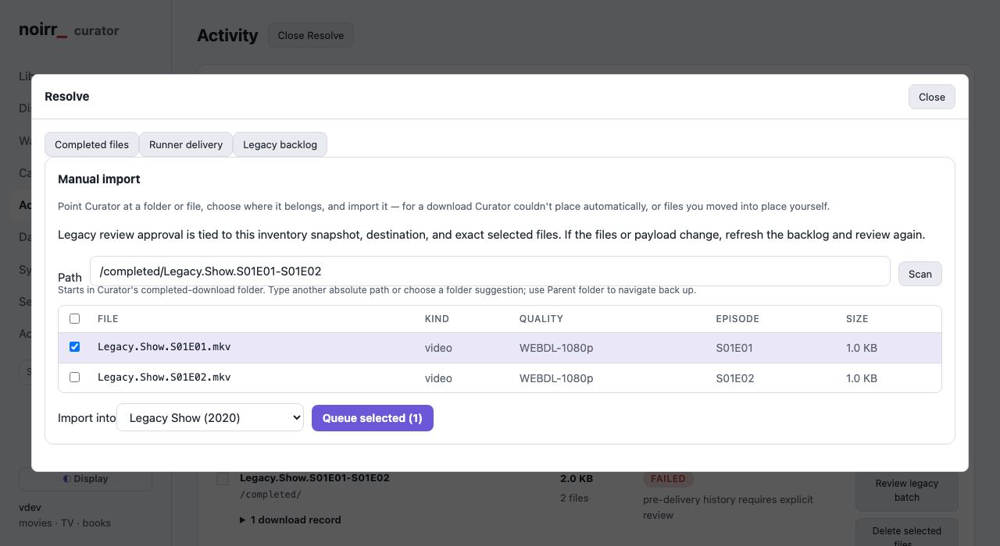

# Download lifecycle — what is broken and how ownership should work

**Status:** operating behavior approved; implementation authorized on 2026-10-22;
see [implementation status](DOWNLOAD_LIFECYCLE_STATUS.md); not deployed  
**Inspected:** 2026-10-22 · **Scope:** Runner, Curator, their shared handoff,
storage cleanup, manual grabs, and search limits

Companion to [the existing recovery ADR](adr/0021-file-lifecycle-recovery.md)
and [the earlier Runner investigation](RUNNER_FAILURE_DIAGNOSIS.md).
This document proposes replacing parts of those operating rules. It does not
claim the proposal is current behavior. Resolve the operating contract here
before writing an implementation plan or changing either application.
Section 1.2 records the user-directed requirements. The flows describe the
proposed design for meeting them; §9 separates remaining engineering
specification from settled behavior. Implementation is authorized; existing
backlog mutations still require review and approval of concrete action batches.
The [replacement API draft](BAD_DOWNLOAD_API.md) supplies the Cinema wire
contract, while §6.3 describes that operation here in the overall lifecycle.

## 1. Conclusion — completion currently stops before responsibility ends

The recurring problem is that successful download, successful import, and
successful cleanup are separate facts without a consistently enforced finish
line. Both applications can report success while the associated storage stays
behind. Guards then prevent deletion, but provide neither an automatic route
back to progress nor a useful explanation at the affected payload.

The existing design has useful integrity checks, placement journals, and retry
receipts. Those should remain internal mechanisms. They should implement one
clear lifecycle rather than expose several different recovery workflows.

The proposed rule is: **every payload has one owner, one recorded purpose,
and an outstanding action until its temporary bytes are gone.**

### 1.1 Evidence and limits

Read-only inspection used live SQLite databases, directory metadata, container
mounts, and source on `nuc3`. No services, settings, queue entries, or media
were changed. The checkout beside this document is older than deployed Curator.

| Source | Inspected revision or observation |
|---|---|
| Local Curator | `ed714b342efe6e68b7a76567033ed3f141852a9b` |
| Host Curator checkout | `863fc712a24259c67f20a04a51fc82d059ab69e8`, version file `0.37.1` |
| Host Runner checkout | `a62f7ec7c8bb5e7149c115445589a35561dbc00f` |
| Containers | Both started on 2026-10-12; source checkout revisions are not independently verified binary build attestations |
| Completed directory | `du -sk`: 853,121,620 KiB, approximately **813.6 GiB** |
| Runner failed directory | `du -sk`: 235,241,285 KiB, approximately **224.3 GiB** |
| Curator download rows | 69 imported, 72 failed, 25 downloading at inspection |

These disk measurements are snapshots, not promised recoverable space. This
audit did not hash every library file, prove equivalence for all completed
payloads, or reproduce each historical duplicate error. Older investigation
findings are not assumed to remain unfixed merely because their documents exist.

### 1.2 Decisions from this discussion

| Topic | User-directed requirement |
|---|---|
| Ownership | Runner owns processing and its failures; Curator owns completed and library import/cleanup |
| Runner's job | Download, verify, repair when possible, extract when needed, deliver usable payload to completed, notify Curator, and clean working files |
| Completion | Handoff and cleanup are explicit, visible operations; leftovers cannot silently become a normal final result |
| Manual Grab | Download/process the selected release and retain it alongside existing library copies; ordinary duplicate or quality checks must not discard the additional copy |
| Failed manual Grab | Retry recoverable failures; on permanent failure purge unusable files unless Keep was selected, report why, and wait for the user to request an alternative release |
| Manual blacklist override | Show the blacklist reason and allow Download anyway for this manual request only; keep the release blacklisted for automatic searches |
| Retention | Keep complete or reasonably recoverable data; purge unusable/unrepairable data rather than applying a blanket retention timer |
| Keep on failure | Explicit per-download opt-in, off by default |
| Explicit disposal versus Keep | A later explicit Delete or Mark bad and replace overrides Keep only for selected disposable files; good siblings and shared files they still need remain protected |
| Retry | Recoverable errors automatically retry, including disk space and I/O; handoff and cleanup are independently retryable |
| Retry timing | Approximately 30 seconds, 1 minute, 2 minutes, then every 5 minutes; elevate the in-app warning after 30 minutes continuously blocked while continuing retries |
| Handoff cleanup boundary | Runner may clean its working files after safe publication in completed plus a restart-safe pending notification; acknowledgement is independently retryable |
| Storage recovery | Automatically recover from ordinary remounts and outages without re-saving settings; pause affected work on unavailable or genuinely different storage |
| Visibility | Preserve detailed stage history and durations; make handoff, cleanup, blockers, and retries easy to inspect |
| Resolution | Recovery/manual import are one workflow leading to placement, reprocessing/reacquisition, or deletion |
| Replacement storage | Do not abandon the failed attempt's files when starting its replacement; purge superseded disposable data |
| Blocked cleanup | Required cleanup blocks replacement admission and automatically retries; explicitly kept failed files, usable quality-replacement output, and shared files needed by good episodes are exceptions, subject to scoped explicit disposal overriding Keep |
| Mark bad | Cinema or Curator can reject bad media, blacklist the offending release as applicable, remove the affected output, and obtain a replacement |
| Automatic library reports | Cinema/Curator may flag suspected bad library media with evidence; deletion, blacklisting, and replacement require explicit user action |
| Season packs | Replace selected episodes without deleting good siblings; ask whether to blacklist the source pack at episode replacement time |
| Partial-pack salvage | Automatically publish/import independently verified usable requested episodes; handle recoverable and failed episodes separately and show partial completion |
| Episode replacement pack fallback | Automatically allow another eligible season pack when no suitable individual episode release is available; import only selected episodes and clean unused outputs |
| Replacement source exclusion | If source blacklisting is declined, exclude the original source from this replacement request only; leave it eligible elsewhere unless independently blacklisted |
| Replacement timing | Remove selected bad media immediately; retain usable media until its quality replacement successfully imports, then clean obsolete selected output while preserving good siblings/shared files |
| Quality replacement | Replacing an episode's quality does not by itself mean its source pack is bad |
| Search limits | Each defined indexer has its own genuine on/off control and allowance; zero must not secretly mean a fixed cap |
| Existing backlog | Produce a read-only per-payload report for processing, failed, and completed; review and authorize concrete action batches before changing existing files |
| Scope | Design review first; Runner/Curator implementation later, with a documented API for Cinema's separate implementation |

Runner cleanup after safe publication with a restart-safe notification obligation
is agreed (§4.1), as is automatic storage recovery (§7.1). API field names,
repairability assessment, and detailed crash-safe protocol mechanics remain
engineering design work. Retry timing is settled in §6.2.
Implementation is authorized; the status page distinguishes completed work from
these operating requirements. Existing backlog action approval is separate.

## 2. What is broken — confirmed mechanisms and their consequences

### 2.1 A device-number change has blocked Curator cleanup for ten days

Curator persists a directory's device number and inode as its root identity.
The saved identity is `[70 39714820]`; the running container now sees
`[69 39714820]` for `/working/monarr`. The inode is unchanged; the device number
differs. The last successful inventory is **2026-10-12**, before the observed
container restart. The current scan preserves that old report and returns
“storage mount identity changed.”

This is an operating-system filesystem identifier, not the directory's name.
A remount or changed mount environment can change it. The timing and unchanged
inode are consistent with that explanation, but do not independently prove
which mount event caused the change.

The same error blocks `safePayloadPath`, which gates both client deletion and
local cleanup. Consequently, a guard intended to prevent deletion on the wrong
storage also stops inventory refresh and leaves cleanup blocked indefinitely.
The cached report accounts for only about 22.5 GiB, while the current completed
directory measures 813.6 GiB. A visible settings warning is therefore hiding a
much larger operational failure.

Cleanup is enabled for the configured Runner client. **All 69 imported rows
still have `payload_removed=0`.** That is database evidence of unconfirmed
cleanup, not a claim that all 69 paths were individually inspected.

Source: deployed `internal/app/acquisition/completed.go`,
`recovery_identity_unix.go`, and `cleanup.go`.

### 2.2 Runner's cleanup stage does not remove the archive inputs

In the inspected Runner source, the production cleanup stage checks
`cfg.cleanup`, then logs “archive inputs retained pending manifest retirement.”
It performs no archive removal there. The later move publishes the job's
directory. The function named `cleanup_dir` is compiled only under `#[cfg(test)]`.
Thus the archive-removal test exercises a helper absent from production.

**Heretic confirms the resulting symptom:**

| Location or record | Observed contents/status |
|---|---|
| Curator download 68 | Imported one file; payload removal unconfirmed |
| Completed payload | 1 MKV: 60,112,821,391 bytes |
| Same completed payload | 115 RAR files: 60,113,123,564 bytes; two small other files |
| Library database | `/media/movies/Heretic (2024)/Heretic (2024) [Remux 2160p].mkv`, recorded size 60,112,821,391 bytes |
| Runner artifact, job 1785 | Completed, owned by Runner, at the completed path |
| Runner relocation source record | Original `/processing/Heretic...` marked deleted |

The handoff records download completion, import, and Cinema notification, but
does not show a cleanup result. Heretic therefore has two contributing defects:
Runner publishes archive inputs with the payload, and Curator cannot finish
cleanup after its recorded import. Equal sizes alone are not a content hash.

Source: Runner `crates/nzbd-post/src/manager.rs`, cleanup and move stages;
live Curator receipts and Runner artifact records.

### 2.3 Storage ownership is declared one way and enforced another

The existing ADR says Curator owns its completed tree. Nevertheless, ordinary
Curator cleanup first asks Runner to delete the payload, then may fall back to
local deletion. Runner still records completed artifacts as owned. Two systems
therefore maintain deletion authority and identity checks for the same bytes.

Curator's inventory survives removal of Activity records, but its automatic
cleanup query starts from live imported `downloads` joined to an enabled-cleanup
client. A historical receipt can explain an abandoned directory without making
it eligible for that sweep. Failed imports and unknown leftovers require other
paths. Accounting is not an enforced route to resolution.

Source: `cleanup.go`, `completed.go`, and
`internal/infra/sqlite/completed.go:ImportedCleanupCandidates`.

### 2.4 Failure retention accumulates holds instead of completing disposal

Runner has lifecycle automation enabled, with seven-day failed retention;
post-processing uses `failure_action="park"`. The failure backlog is not
explained simply by automation being disabled.

The live inventory has 20 artifacts in `delete_failed`, each reporting a root
identity/volume problem. Non-deleted records under the failed tree include
36 relocation-staging review holds and 20 other review holds. Other records
report missing terminal evidence, changed scratch identity, or uncertain Keep
provenance. Some recorded filesystem errors may be historical; the audit does
not claim each operation is actively recurring.

Existing retention rules count eligible daemon uptime as well as wall time;
holds extend the period. These are useful protections individually, but their
combined effect is that “retain for review” can become permanent storage.

Curator's generic failure handling can initiate replacement acquisition without
itself completing a purge of the old Runner attempt. Some newer planner paths
have additional cleanup state, but there is no single enforced contract covering
every entry point. Replacing the download does not mean replacing its storage.

### 2.5 Manual-grab intent disappears before import

The deployed `GrabRequest` has no explicit durable “additional copy” intent.
Its default copy is the primary. Admission can return an existing reservation
on title or target overlap rather than create the user's new requested copy.

At import, `runImport` starts with `manual=false`. It switches to true only
when it finds a `manual_import_queued` step from the separate manual-import
workflow. A manually selected search result does not establish that step.
The resulting normal import can reject a file because it does not improve
the existing copy.

Even setting that boolean would not fully satisfy the requirement: movie and
episode import can still classify a manually imported higher-quality file as
an upgrade and remove existing files. “Manual override” and “keep both” are
different contracts.

The live failure list includes “does not improve on ... already here” and
unresolved obfuscated episode filenames. The available records do not prove
which of those individual grabs were manual; the source defect stands without
assuming their origin.

Source: deployed `acquisition.go:Grab`, `handoff.go:runImport`, and
`import.go:importMovieFile/importEpisodeFile`.

### 2.6 The search setting has hidden limits beyond the stated cap

The deployed `RequestBudget` converts a cap of zero **or less** into 250
requests per rolling 24 hours. It also partitions the allowance: automatic
search gets at most 100 requests/day and at most half its search share within
12 hours. Raising the overall number therefore does not remove that automatic
search ceiling. Manual searches borrow only specified buckets.

These are Curator policies, separate from a provider's own restrictions.
There is no genuine off mode in the inspected code.

Source: deployed `internal/infra/sqlite/indexer_budget.go` and
`web/src/pages/SettingsAcquisition.tsx`.

### 2.7 The operator sees several partial stories

Ordinary handoff steps, completed-folder inventory, Runner Files, recovery
staging, and manual import expose different views of the same unresolved work.
Existing recovery can require an original, a published recovery copy, and a
library copy, plus replacement rollback storage. It has a separate mounting,
credential, claim, and receipt workflow.

The complexity is not just the number of screens. A user cannot start with a
leftover directory and reliably see: who owns it, whether it was imported,
why it remains, which exact action will remove it, and when that happens.

## 3. Proposed contract — one owner at each boundary

These are proposed operating rules, not new promises about the running apps.

| Storage | Owner | Allowed purpose | Exit condition |
|---|---|---|---|
| Runner processing | Runner | Download, verification, repair, extraction, publication staging | Published output is durable, or attempt is discarded; working files removed |
| Runner failed | Runner | Recoverable material with a concrete next step, or an explicit per-download keep choice | Reprocess, salvage, or purge; unrecoverable/superseded attempts purge after workers stop unless explicitly kept |
| Completed staging area | Runner until publication | Incomplete transfer to the completed filesystem | Publish atomically or clean the failed staging attempt |
| Published completed payload | Curator | Ready-to-import material | All files resolved, then completed payload removed |
| Library | Curator | Accepted media copies | Only an explicit library operation or applicable automatic upgrade policy changes them |

**Publication is the ownership boundary.** Runner may prepare a private staging
directory on the completed filesystem, but Curator cannot import it. The final
published generation belongs to Curator. Runner subsequently cleans only its
own sources and scratch. It does not delete or mutate the published payload.

Directory names include a unique attempt identity. A release title is a label,
not an identity or a lock. Retries of the same request return the same attempt;
a new deliberate manual grab creates a different request and destination.

## 4. Normal flow — publish payload only, then finish both cleanups

```text
 CURATOR                              RUNNER
 Record request + purpose ----------> Download into owned processing dir
                                      |
                                      v
                                      Verify received files
                                      |
                                repair needed?
                                 yes /       \ no
                                    v         |
                               Repair + verify|
                                    |         |
                                    +----+----+
                                      |
                                      v
                               Extract when required
                                      |
                                      v
                         Build output manifest: usable payload
                         + wanted sidecars; no consumed archives
                                      |
                                      v
                         Publish complete payload atomically
                         at completed/<attempt>/
                                      |
                 OWNERSHIP TRANSFERS TO CURATOR
                                      |
                         Persist restart-safe notification obligation
                                      |
                         +------------+---------------------+
                         |                                  |
 Accept durable handoff <-+ Retry ready notification          v
 |                         until acknowledged       Remove Runner working files
 |                                                  Record cleanup result
 v
 Import under the recorded request purpose
 |
 v
 Commit library files + metadata + per-file results
 |
 v
 Remove resolved completed payload; verify disappearance
 |
 v
 DONE when library outcome and BOTH owners' cleanup are recorded
```

Runner publishes extracted outputs plus valid directly downloaded media and
chosen sidecars. It uses its transformation records to identify consumed
archives and repair inputs; it does not blindly delete every file with an
archive extension. An archive that is itself an intended library format must
remain a deliverable.

“Ready” means Runner's integrity/extraction requirements have passed; it does
not promise that every obfuscated filename already has a known episode mapping.
Mapping failures go to Curator's one resolution workflow, without redownloading
verified bytes by default.

Curator imports files transactionally using the existing placement coordinator.
Every manifest entry ends as imported, satisfied by a verified existing copy
(automatic requests only), explicitly discarded, or unresolved. One imported
episode is not permission to delete unresolved siblings in a season pack.
Cleanup proceeds per resolved file when a payload is only partially resolved.

**Explicit deletion replay:** before deleting a selected Delivery-managed batch,
Curator durably records the complete selection, each reviewed file and parent
identity, receipt generation, publication identity and expected storage. If the
process stops after an unlink, retry resumes that same batch even after a fresh
inventory scan changes its fingerprint. It cannot add files to the approved
selection. A new object at a deleted path requires new review. Completion and
its history event commit together, so a database failure leaves a retryable
operation with a visible eventual result. The local cleanup worker discovers
pending batches after restart and retries them on the normal cleanup schedule,
even while Runner is offline. Retry now uses the saved batch; it does not need
the browser to retain the original request. A generic old pending-cleanup row
cannot grant this replay authority.

```text
 Review exact files + publication + storage
                    |
                    v
 Commit complete batch before any unlink
                    |
                    v
 Recheck file / parent / storage --> changed --> Hold for new review
                    |
                    v
 Unlink selected file + sync parent
                    |
                    +-- crash / DB failure --> Reload exact batch
                    |                          Prove same parent + absence
                    |                          Retry completion
                    v
 Commit removed outcome + history together
                    |
                    v
 Continue selected siblings only
```

### 4.1 Communication — durable facts instead of a fragile notification

Reuse the existing transfer identifier and journals. The minimum shared facts
are request/attempt ID, purpose, payload generation, published path, file list,
integrity evidence, and each side's progress/result. Each fact names its owner.
Do not introduce a new message broker just for this contract.

```text
 Runner publishes + records READY
              |
              +-- notification lost --> resend same READY
              |                         or Curator discovers manifest
              v
 Curator records ACCEPTED once
              |
              +-- acknowledgement lost --> repeat returns same acceptance
              v
 Curator records per-file import/discard outcomes
              |
              v
 Curator records COMPLETED CLEANUP result

 Runner independently records PROCESSING CLEANUP result
              |
              v
 Shared timeline joins these facts by request + attempt + generation
```

Acceptance acknowledges durable responsibility, not library success. A lost
response never starts a second download, second publication, or second import.
**Agreed, 2026-10-22:** Runner can retire processing bytes once the complete,
verified payload is safely published in completed and the pending notification
is durably recorded to survive restarts. Curator acknowledgement is not a
prerequisite for this cleanup; Runner need not keep a second full copy while
Curator is offline. Failed publication retains recoverable working files and
retries. Notification continues independently until acknowledged.
The published manifest and retryable record allow adoption when Curator returns.
An accepted handoff remains recognized after Curator has imported and deleted
the source: late notifications cannot recreate finished work.

### 4.2 Handoff and cleanup are independently retryable steps

**User direction, 2026-10-22:** show handoff and cleanup as explicit steps,
including their time spent, and make both retryable.

| Step | Completion evidence | What Retry does |
|---|---|---|
| Handoff: publish payload | Complete payload and manifest durably published at the recorded destination | Resume/reconcile the existing publication; reuse verified staged data rather than copying a second payload |
| Handoff: notify and acknowledge | Curator has durably accepted the same request, attempt, and payload generation | Redeliver the same handoff or recover its existing acknowledgement; never enqueue another import for an already accepted generation |
| Runner cleanup | Owned processing sources and disposable scratch removed, with recorded verification | Retry only outstanding Runner-owned removals for that attempt |
| Curator cleanup | Resolved completed files removed, with recorded verification | Retry only outstanding Curator-owned removals after their import/discard decisions are committed |

Use one visible Handoff step with publication and acknowledgement details.
Show Runner cleanup and Curator cleanup separately because they own different
paths and may fail independently. Failure/discard cleanup uses the same timed
cleanup presentation, with its disposal reason rather than an import receipt.

Transient failures retry automatically with backoff and a visible next attempt.
Each failed or waiting step also has **Retry now**. This rechecks prerequisites
and resumes that operation; it does not bypass a missing mount, active writer,
explicit Keep, or unresolved import decision. If still blocked, show the exact
reason and required action on that step. An already running operation cannot
be duplicated by clicking Retry again.

Retries preserve the original operation identity and its prior attempts. A
timeout means the outcome is unknown until reconciled, not that the operation
definitely failed. If publication, acceptance, or deletion already succeeded,
the retry records that result and finishes without repeating downstream work.
Missing files count as removed only when the expected storage is reachable
and their absence can be verified.

Handoff/cleanup retries never redownload, re-extract, or repeat a committed
library import. They survive application restart and browser closure. Runner
cleanup and Curator import may overlap once publication is durable; the UI
shows that overlap rather than inventing a strictly sequential timeline.

## 5. Manual flow — the additional copy is the purpose

**Required by the user:** a manual grab requests download, processing, and
retention alongside existing copies. Existing title, quality, or release
presence does not veto it. A higher quality does not turn it into replacement.

```text
 User chooses a release and presses Grab
                  |
                  v
 Persist purpose = ADDITIONAL COPY
 Allocate a distinct library copy and attempt
                  |
                  v
 Runner downloads / verifies / repairs / extracts / publishes
 (existing release history does not veto this explicit request)
                  |
                  v
 Curator imports to the allocated copy destination
                  |
                  +---- existing copy remains
                  |
                  v
 Remove temporary files in processing and completed
                  |
                  v
 Library contains both copies
```

Automatic acquisition uses `fill/upgrade` purpose and its configured policy.
An explicitly labeled replacement action uses `replace selected copy`.
Plain manual Grab never implies replacement. These are durable intent
fields, not conclusions inferred from a log entry or filename.

Two distinctions must survive every layer:

- Repeating delivery of the **same click/request** is idempotent and creates
  one copy. A **new deliberate grab** is a new request, even for the same NZB.
- Byte-identical manual copies still have separate logical library identity
  and paths. Hardlinks may share physical blocks where supported; neither
  copy is discarded on the grounds that it already exists.

The additional copy is retained as an independent version, outside automatic
replacement unless the user explicitly changes its policy. Runner performs
normal integrity and path checks; manual intent does not make corrupt bytes
valid.

**Agreed, 2026-10-22:** a permanently failed manual grab stops and lets the user
decide whether to find a replacement. Report the reason and purge unusable files
unless Keep on failure was selected; do not automatically choose another
release. Recoverable failures continue automatic retries of the same attempt.
Offer **Find a replacement** as an explicit action. Manual Grab does not imply
Keep on failure.
An explicit Mark bad and replace action (§6.3) does authorize seeking a
different release for that same additional-copy request.

**Agreed, 2026-10-22:** a manual grab of an explicitly blacklisted release shows
the blacklist reason and offers **Download anyway**. This override applies only
to that manual request, including its retries, and survives restart. It does
not remove the blacklist or make the source eligible for automatic searches or
unrelated requests. Ordinary duplicate history never requires this override.

## 6. Failures and leftovers — one Resolve workflow

Recovery and manual import become one user-facing workflow, **Resolve**, reached
from the download or the directory. Selecting an external folder is another
input to that workflow. Internally, Runner still owns any Runner-side work;
Curator does not delete processing files directly.

```text
 Failure or leftover discovered
              |
              v
 Identify request, owner, actual files and last committed result
 Assess recoverability using the decision in section 6.1
              |
       +------+-------------------+---------------------+
       |                          |                     |
       v                          v                     v
 IMPORT / MOVE                RETRY / REPROCESS       DELETE
 Use existing useful bytes    Resume same attempt     Stop active writers
 Choose mappings if needed    at failed stage         Purge owned files
 Commit library result        Reuse verified bytes    Verify disappearance
 Clean source afterward       Then normal flow       Record disposal
       |
       +-- automatic copy already satisfied?
           Verify library coverage, then dispose of redundant payload
           (never apply this shortcut to ADDITIONAL COPY intent)

 Replacement download needed:
 mark old attempt superseded -> stop workers -> purge old attempt
 -> verify cleanup -> admit replacement attempt

 Explicit Keep is the exception; scoped episode replacement preserves
 good sibling/shared files, and quality replacement keeps usable output
 until its replacement commits (section 6.3).
```

“Import/move” means placement in the library or an explicitly chosen final
destination, not moving garbage between temporary folders. Salvage of Runner
files publishes selected verified output through the same completed handoff;
it does not require a permanent parallel recovery staging system.

| Situation | Required behavior |
|---|---|
| Disk full, mount missing, permission/I/O failure | Retain complete or recoverable bytes and pause/resume the same attempt after the condition clears; reverify affected bytes before use |
| Repairable archive failure | Repair and reverify in place; one attempt owns the work |
| Download cannot complete and remaining data cannot be repaired or salvaged | Stop workers and purge immediately unless Keep on failure was explicitly selected; no retention grace period |
| Health below what available/requestable repair data can recover | Stop and purge the unusable data unless explicitly kept; do not keep downloading a mathematically unrecoverable set |
| Unusable release requiring replacement | Quiesce and purge the superseded attempt, including owned scratch, before its replacement starts; an explicit keep choice is a visible exception |
| Import cannot identify episode/title | Preserve usable bytes with a concrete mapping action in Resolve; do not download the same content again to solve a naming issue |
| Automatic request already satisfied | Verify the actual target/copy/episodes and applicable quality policy; dispose of redundant source and record why |
| Manual additional copy | Import alongside existing copies; “already have it” is not a disposal reason |
| Cleanup fails | Keep a visible cleanup-pending task with reason and next retry; never present it as fully done |
| Published files lack an Activity row | Reconstruct from manifest/receipts; history visibility must not control cleanup ownership |
| Old unrecognized files | Inventory and reconcile through Resolve; no guessed bulk deletion by title or age |

Starting a replacement is a recorded decision that the old attempt is being
abandoned. If useful files are to be salvaged, import those first and purge the
remainder. An explicit keep request is an exception visible to the user, not a
default hidden hold. A failure to purge prevents replacement admission and
names the blocking filesystem operation; it does not quietly grow a second
full payload.

### 6.1 Retain by recoverability, with an explicit per-download exception

**User direction, 2026-10-22:** retain failed material only when it is already
usable or has a reasonable path to becoming usable. Failure reason and the
actual condition of the files determine retention. This replaces the earlier
24-hour grace-period proposal; there is no blanket failure-retention timer.

```text
 Attempt fails -> stop its workers and assess the actual files
                         |
              Keep on failure explicitly selected?
                 yes /                  \ no
                    v                    v
           Retain failed files    Usable output or concrete recovery path?
           Label operator choice      yes /                  \ no
                                         v                    v
                              Retain needed bytes       Purge owned files
                              Record next action        Verify removal
                              Resume / repair / import  Retain error/history

 Keep prevents disposal; it does not disable automatic recovery retries.
```

Examples of a concrete recovery path are retrying a temporary I/O failure,
resuming publication when completed has free space, restoring a missing mount,
repairing with sufficient available or fetchable PAR data, or mapping a complete
media file to its library destination. A failure label alone is insufficient:
an I/O error can also reveal unrecoverable corruption, so affected data must be
reverified. A temporary provider outage is not proof that a download can never
complete; exhausted source/repair options are a different outcome.

Retention requires a recorded reason, evidence of usable/recoverable data, and
the next operation or condition needed. Automatically retry when that condition
clears. If new evidence rules out recovery, purge rather than leaving a review
hold indefinitely. Unknown repairability calls for a bounded diagnostic check,
not a standing Keep decision. The diagnostic budget and exact repairability
calculation must be specified before implementation; no generic health
percentage should replace the archive set's actual repair requirements.

**Agreed, 2026-10-22:** automatically salvage usable episodes and handle failed
episodes separately. Assess independent outputs individually. If a failed season
download contains
verified complete episodes, salvage those and purge the unusable remainder;
one useful file does not justify retaining every broken archive and scratch
copy. Retain only inputs necessary for the remaining recovery operation, or
explicitly kept failed files. Publish independently verified, correctly mapped
requested episodes through the normal handoff/import flow, showing per-episode
outcomes and partial completion rather than marking the whole pack successful.
A manually grabbed pack still requires explicit user action before seeking
another release for its permanently failed episodes.

```text
 Partially failed season pack
              |
              v
 Assess requested episodes independently
              |
     +--------+---------------------+-----------------------+
     |                              |                       |
     v                              v                       v
 Complete + verified          Recoverable              Unrepairable
 Publish and import           Retain needed inputs     Purge unusable bytes
 through normal handoff       Repair/retry              unless explicitly kept
     |                              |                       |
     +------------------------------+-----------------------+
                                    |
                                    v
                         Record per-episode outcomes
                         Show partial completion honestly

 Manual pack: failed episodes await an explicit replacement decision.
 Automatic request: replacement covers only the still-unfulfilled targets,
 subject to required cleanup and all source exclusions.
```

**Per-download control:** `Keep files if this download fails`, off by default.
It can be selected before failure and changed while the attempt is retained.
The choice is durable and belongs only to that selected download; replacement
downloads do not inherit it implicitly. It preserves failed files even when
recovery is unlikely, with an explicit `Kept by you` reason. It does not disable
ordinary cleanup after a successful handoff/import, change integrity results,
or block a separate explicit Delete action.

**Agreed, 2026-10-22:** a later explicit **Delete** or **Mark bad and replace**
overrides Keep for the selected disposable files only. State that those retained
files will be removed; do not require the user to turn Keep off first. Automatic
processing still respects Keep, and good siblings/shared files they need remain
protected. This does not grant an automated problem report permission to override
Keep.

Turning Keep off reruns the recoverability decision. It does not automatically
delete complete or recoverable material. Selecting Keep must serialize with
purge admission; once deletion is underway or finished, the UI must not claim
it can preserve or restore files already being removed.

Imported/redundant payloads and abandoned attempts have no grace period:
cleanup is immediate and retries persist until confirmed. If an explicitly
kept failed attempt is replaced, show the retained bytes and operator choice;
that deliberate exception permits replacement without purging the kept files,
subject to available space. Otherwise purge precedes replacement admission.

An inaccessible or unverified storage root still blocks deletion authority.
That is a cleanup/inspection fault with a named next action, not a decision
that its files deserve retention. Legacy unknown files must be inspected and
attributed before applying this policy. Keep the fault visible and apply
capacity backpressure rather than silently accumulating more downloads.

### 6.2 Recoverable errors retry automatically throughout the lifecycle

**User direction, 2026-10-22:** automatic retries apply to recoverable errors
at every stage, including disk-space and temporary I/O failures, not just
handoff and cleanup. Keeping recoverable files must come with active recovery.

```text
 Recoverable error -> pause affected work; preserve verified progress
                              |
                              v
                   Schedule automatic retry with backoff
                              |
                              v
                   Recheck the blocking condition
                     | still blocked      | cleared
                     v                    v
               Record reason;       Revalidate affected data
               schedule next check  Resume the same attempt/stage
```

Use capped backoff, with jitter to avoid all waiting downloads restarting at
once. A storage-recovery signal can trigger an earlier check; periodic checks
remain the fallback. Disk-full checks establish sufficient space for the next
operation before restarting it. Admission coordinates waiting work so several
jobs do not each consume the same newly available capacity. I/O retries
reconcile partial writes/copies and verify affected bytes before continuing.

Show `Waiting for space`, `Retrying I/O`, or the actual dependency on the
affected step, with attempt history, elapsed waiting time, next check, and
**Retry now**. Retry scheduling persists across application restarts and does
not depend on an open browser. Continue checks while the recovery path remains
valid; a retry count alone does not turn a resource failure into a corrupt
release or authorize purging recoverable media. Prolonged failure raises a
visible alert while checks continue.

**Agreed, 2026-10-22:** retry after approximately 30 seconds,
then 1 minute, 2 minutes, and every 5 minutes thereafter, with small timing
variation to spread concurrent work. Storage-recovery signals can trigger an
earlier check. Honor longer provider-directed retry delays. After 30 minutes
continuously blocked, elevate the existing in-app warning while continuing
retries; do not create another alert for every attempt. This is not a retention
deadline or a maximum attempt count. Discovery of alternative releases remains
subject to its separate search scheduler and per-indexer allowances.
Keep **Retry now** available; it rechecks the condition without bypassing
capacity, ownership, or provider restrictions.

Retry the failed operation within the same download attempt, retaining manual
additional-copy intent. Do not blocklist the release, acquire a replacement,
or restart completed stages merely because storage is temporarily unavailable.
If an interrupted operation cannot resume internally, rerun only that stage
from verified inputs after reconciling its previous scratch and outputs.
New evidence of actual unrecoverability returns to the purge/Keep decision in
§6.1. A mapping decision or deliberately paused/cancelled download is not a
transient error: retries must not guess the user's choice or override it.
Keep on failure does not itself pause recovery of recoverable material.

### 6.3 Replacement — select the affected media and blacklist separately

**User direction, 2026-10-22:** either Cinema or Curator can mark a download bad
and replace it. For season packs, an episode can be replaced independently,
preserving the good episodes. At the time the user requests episode replacement,
ask whether to also blacklist the source pack. Replacing an episode's quality
does not imply the pack is corrupt. Runner and Curator implementation are in
scope; Cinema's integration is separate against the documented API.
See [the proposed API contract](BAD_DOWNLOAD_API.md) for the integration shape.
Neither the endpoint nor this workflow is implemented by this proposal.

**Agreed, 2026-10-22:** remove selected bad media immediately rather than waiting
for its replacement. Keep usable media available until its quality replacement
successfully imports, then remove obsolete selected output. Failed quality
replacement leaves the usable existing copy available. Good sibling episodes
and physical files still needed by them remain protected. A normal manual Grab
continues to add a copy alongside existing copies; it is not a replacement.

```text
 Cinema or Curator: Replace selected episode(s) or whole download
                                |
                                v
 Record reason: bad media or quality replacement
 For episodes: ask whether to blacklist the source pack
                                |
                                v
 Curator records exact targets/copy + explicit blacklist choice
 Good sibling episodes stay in place under EITHER choice
                                |
                                v
 Bad media: remove selected bad output, preserving shared good files
 Quality replacement: keep current usable output until replacement commits
                                |
                                v
 Acquire another eligible release for selected targets only
                                |
                                v
 Import selected replacement(s); clean obsolete selected output/temp files
```

This works after a successful import as well as during acquisition. Retain
download-to-library provenance after Activity is cleared so Cinema can report
the source of a bad file later. Curator coordinates the operation; Cinema
does not directly erase files or independently submit a replacement to Runner.
Runner acts only within the scoped operation and returns durable cleanup
results. A selected episode does not authorize purging a whole active pack.

When selected, the blacklist identifies the source release using stored
indexer/release identifiers and known equivalent content identities where
available. It does
not blacklist the film, series, episode, quality, or every release with a
similar title. Check it during search and immediately before submission,
including manual grabs. Unlike ordinary duplicate checks, this is an explicit
rejection: a normal manual Grab does not silently override it. Reinstating a
blacklisted release would be a separate deliberate action.

Preserve the original request's copy identity and the selected coverage.
Replacing a bad manual additional copy seeks another release for that copy;
an existing primary
copy cannot make the replacement request disappear. The bad-copy replacement
does not create an extra additional-copy slot on every retry.

Episode replacement and whole-download rejection are separate scopes in the
initial contract. Selecting S01E05 replaces S01E05, not its siblings, even when
they arrived in the same pack. Multiple selected episodes are explicit targets.
Whole-download rejection remains a distinct action; do not infer it from a
playback failure in one episode.

The episode replacement dialog shows the selected episodes, copy, source pack,
and reason. Ask: **Also blacklist this source release from future downloads?**
Offer `Replace selected episodes only` and `Replace and blacklist source pack`.
Require an explicit answer on each action; do not infer it from the reason,
remember a hidden default, or silently apply a season-wide ban. Both choices
preserve good episodes. Blacklisting a pack affects future acquisition, not
existing good library files, and never blacklists the season itself.

**Agreed, 2026-10-22:** when source blacklisting is declined, exclude the original
source from this replacement request only, so it does not immediately reacquire
the episode being replaced. The exclusion survives retries and restarts without
becoming a global blacklist. The pack remains eligible for other requests unless
independently blacklisted. Quality replacement seeks a different
release meeting the selected copy's quality objective; if none is available,
keep the usable current episode and show the pending request. Bad media is
removed from the selected target, following the existing cleanup-before-replace
rule. A single physical file serving both selected and unselected episodes
must stay while good episodes still reference it; detach the rejected mapping
and import its replacement separately. Never widen deletion to good episodes
just because they share a file.

**Agreed, 2026-10-22:** prefer suitable individual episode
releases. If none is available, allow another eligible season pack to supply
the selected episodes without a separate approval. The larger download requires
sufficient working space and remains subject to source exclusions and the
requested quality objective. If an alternative pack is required, only the selected
episodes are replacement targets: importing that pack must not overwrite good
siblings. Resolve and clean its unneeded outputs without turning them into
additional library copies or new replacement requests.

Make this a durable, retryable operation: repeated reports return the same
operation, and notification/cleanup/search retries do not multiply replacement
downloads. Late events cannot restore a rejected episode mapping or overwrite
its replacement; unselected pack outputs can still complete normally. An
identity conflict blocks the affected removal with a specific reason; it never
licenses deletion of a new file at an old path.
**Agreed, 2026-10-22:** blocked required cleanup holds up replacement until the
disposable files are removed. Retain the chosen blacklist decision and
replacement intent, show the blocking reason and next retry, and retry cleanup
automatically. Explicitly kept failed files, usable media awaiting quality
replacement, and shared files needed by good episodes do not require removal
before replacement starts. Explicit Delete/Mark bad and replace still overrides
Keep for its selected disposable files. Quality replacements retain the current
usable output until the new output commits.
If no acceptable alternative exists, show `Waiting for another release` and
revisit discovery through the normal scheduler/provider limits.

Mark bad and replace explicitly requests disposal within the selected scope,
so it overrides Keep on failure only for those disposable files. Shared inputs
needed by good episodes remain protected. Merely logging an error does not
invoke this action, and quality replacement does not label the source corrupt.
Disk full, temporary I/O, a missing mount, or a Cinema playback/transcode failure
without evidence against the media must follow recoverable-error handling;
they are not by themselves grounds to blacklist a release.

**Agreed, 2026-10-22:** automatic reports from Cinema or Curator flag library
media for review, identifying the affected file and available evidence. They
cannot delete, blacklist, or replace library media without an explicit user
action, even when the diagnostic evidence is strong. Episode replacement still
asks whether to blacklist the source pack. An explicit user Mark bad action
can record the user's stated reason without guessing a diagnosis. Runner's
automatic integrity checks and the agreed purge/Keep policy for incomplete or
unrepairable downloads remain unchanged; this review requirement concerns
problems discovered in library media.

## 7. Storage identity and search limits — make the controls literal

### 7.1 Mount handling must distinguish unavailable storage from renumbering

**Agreed, 2026-10-22:** storage must recover automatically without re-saving
settings or manually accepting ordinary mount changes. Pause affected operations
while expected storage is unavailable, retry automatically, and resume when it
returns. Device-number changes alone must not require intervention.

Keep protection against operating on a replacement disk or an unmounted local
directory. Verify the expected storage without requiring a routine storage
registration or revalidation ceremony. The exact verification mechanism remains
an implementation detail to validate against the deployment's mounts and bind
aliases. Current device/inode checks can still help detect changes during a
single mutation; they are not persistent proof of storage replacement.

```text
 Can the configured storage be reached?
       | no                         | yes
       v                            v
 Pause affected operations    Verify expected storage
 Name missing mount                 |
 Retry on recovery           +------+-------------------+
                             | verified                | different/invalid
                             v                         v
                     Accept ordinary remount     Pause affected operations
                     Scan and resume work        Show expected/actual storage
                                                 Explain required correction
```

A changed device number alone must not freeze the inventory for days. Read-only
observations of questionable storage can be displayed separately from the last
trusted inventory. Do not describe questionable bytes as verified or reset all
root identities because the user re-saved an unrelated settings form.

The user-facing error should say, for example: “Completed storage is unavailable.
Retrying in 30 seconds.” The countdown reflects the actual scheduled retry.
Show affected jobs/bytes and explain expected versus observed storage when a
genuinely different destination or invalid configuration requires correction.
Transient uncertainty remains a visible, automatically retried check. Keep
per-download ownership and path-containment checks independent of mount checks.

### 7.2 Local search budgets need an actual off switch

**User direction: limits belong to each defined indexer, because their
allowances can differ.** In each indexer's settings, provide **Limit requests
locally: Off / On** and, when On, an explicit requests-per-rolling-24-hours
number. Persist these against that indexer's identity. There is no global
allowance that silently overrides the individual settings.

Off removes every Curator-imposed daily, bucket, and 12-hour allowance
restriction for that indexer across automatic search, interactive search,
and RSS. There is no hidden fallback of 250 or automatic ceiling of 100.
One indexer exhausting its local allowance does not block another eligible
indexer. Each indexer's usage, remaining allowance when enabled, next available
request time, and provider throttling are visible separately. Changing one
indexer cannot change another's cap or reset its usage accounting.

Concurrency limits, configured RSS cadence, and provider `Retry-After` responses
remain separate mechanisms. Turning off a local daily cap does not claim that
the provider permits unlimited traffic or make RSS run continuously. Retain
usage accounting in both modes and explain provider throttling separately.
Persisted current limits must migrate visibly per indexer; do not reinterpret
an existing zero as a changed behavior without showing the new mode. An indexer
can have no local cap while another has, for example, 500 requests per rolling
24 hours. Provider limits and account entitlements are separate from these
user-configured Curator controls.

## 8. Visibility — start from the leftover directory

Extend Curator's existing Activity page and its Download storage panel rather
than introducing a new top-level Downloads or Storage page. Active, cleanup
pending, finished, and failed states remain views of the same lifecycle records,
including legacy unknown directories. Recovery and manual-import links open
Resolve on the selected record. Runner retains its existing Queue, History,
Files, Logs, and Settings tabs.

Each payload displays owner, purpose, processing/completed/library locations,
bytes by location, last successful action, current blocker, next action/retry,
and a joined timeline. Every cleanup record names both the requested operation
and its verified result. Deleting an Activity display row does not delete this
lifecycle record while bytes or obligations remain.

### 8.1 Preserve stage detail and show where time is spent

Keep the useful existing processing detail: queued, downloading, verification,
repair, extraction, and any actual renaming or script stages. Add explicit
Handoff, Runner cleanup, Import, and Curator cleanup steps. Verification after
repair is shown as a real repeat, not silently folded into the first check.
Steps that are unnecessary say `Not needed`, with a reason, instead of looking
unfinished or disappearing from an otherwise confusing history.

Every step shows its responsible application, status, start/end timestamps,
and elapsed time. For waiting or retried work, distinguish time actively
working from time queued, paused, or waiting for a dependency. Show current
attempt number, previous attempts and errors, next automatic retry, and the
applicable Retry control. Include bytes/files processed and remaining when
measurable; do not invent progress percentages for an unknown amount of work.

Persist timings and attempt transitions. A restart or retry must not reset the
display to make a long-stuck step look new. Overall elapsed time runs from the
original request; it is not the sum of stages that may overlap. Each service
measures its own durations; do not derive handoff latency by subtracting clocks
on different hosts. Historical or interrupted work without reliable timing
evidence says `Unknown` rather than reporting fabricated precision.

Illustrative display only; these are not timings measured for Heretic:

```text
 Step                 Owner     Status               Active     Waiting
 Download             Runner    Complete             18m 42s     1m 10s
 Verify               Runner    Complete                 32s         -
 Repair               Runner    Not needed                -         -
 Extract              Runner    Complete              2m 08s         -
 Handoff              Runner/   Accepted                 14s       45s
                      Curator   Published; ack on attempt 2
 Runner cleanup       Runner    Complete                  3s         -
 Import               Curator   Complete              4m 16s         -
 Curator cleanup      Curator   Waiting: mount unavailable
                                                        2s     12m 03s
   Attempt 3 failed. Next retry in 2m. [Retry now] [Show paths and error]

 Library: Available             Lifecycle: Cleanup pending
```

### 8.2 A leftover directory opens the same timeline

Example of the proposed presentation for Heretic:

```text
 Heretic                         Imported - cleanup blocked
 Purpose                         Unknown from historical record
 Owner of completed payload      Curator
 Completed                       120.23 GB logical
   Extracted media                60.11 GB
   RAR inputs                     60.11 GB
 Library                         Import recorded; destination shown
 Why files remain                Storage identity verification failed
 Next action                     Automatically check expected storage;
                                 resume cleanup when available

 Timeline: grabbed -> Runner ready -> import committed -> Cinema notified
           -> cleanup blocked [reason] -> next retry / resolution action
```

Use separate labels for library availability and lifecycle completion. A film
can be available in Cinema while Downloads says “Imported; cleanup pending.”
Alerts should name blocked bytes and duration. Physical space reclaimed is
measured separately from logical file size, especially for hardlinks.

### 8.3 Render the additions within the actual existing layouts

**User clarification:** interface review must show what the changes would look
like in the real applications. This is not authorization for a new application
shell, navigation redesign, or replacement of unrelated pages. The initial
generic renderings overstated that scope and are superseded by previews based
on the running applications' Classic layout, inspected in the browser.

| Existing surface | Proposed addition or adjustment |
|---|---|
| Curator sidebar | Preserve Library, Discover, Wanted, Calendar, Activity, Dashboard, System, Settings, and Access |
| Curator Activity row expansion | Extend the current inline timeline with work/wait durations, handoff attempts, both owners' cleanup, and retry actions |
| Curator Activity Download storage panel | Keep its current placement; add owner, reason retained, next action, and links into the same timeline/Resolve workflow |
| Curator Activity Manual import panel | Replace with the unified inline Resolve panel; recovery links lead to this same workflow |
| Curator Settings Recovery entry | Route to Resolve instead of maintaining a second recovery UI |
| Curator Settings Indexers table | Keep per-row editing; replace Request cap with an explicit Off/On request-limit editor for that indexer |
| Curator library episode table | Add Replace beside existing Search; keep monitoring checkboxes dedicated to monitoring |
| Curator replacement dialog | Show selected episode/copy, bad-versus-quality reason, and required source-release blacklist choice |
| Curator System completed-folders warning | Show unavailable storage, affected files, and next automatic retry; request correction only for genuinely different storage or invalid configuration |
| Runner header and navigation | Preserve centered layout, rate/capacity summary, queue controls, and horizontal tabs |
| Runner Queue/History details | Extend current expandable rows and processing-stage chips with handoff, cleanup, waiting reasons, and independent retries |
| Runner Files table | Replace age-based retention explanations with recoverability, explicit Keep, ownership, and concrete next action |

The original interactive previews are saved with these docs:
[Runner existing-layout proposal](renderings/download-lifecycle/runner-proposal.html)
and [Curator existing-layout proposal](renderings/download-lifecycle/curator-proposal.html).
Open the HTML files in a browser to inspect their simulated controls. They are
design references; the implementation captures below show the built candidate.

The previews use illustrative file states and simulated actions. Selected
library/settings sections are shown at their relevant scroll positions; the
other existing sections are not proposed for removal. They do not connect to
production or implement the operating contract.

### 8.4 Captures of the implementation under review

These captures show the actual locally built Curator interface with fabricated
browser-test data at 390px and 1280px. They preserve the existing application
layout. The primary reviewed the captures after the web assets were rebuilt;
focused browser tests check action visibility, selection scope, keyboard focus
and dismissal. Full integration validation is tracked separately in
[implementation status](DOWNLOAD_LIFECYCLE_STATUS.md).

| Surface | Desktop | Phone |
|---|---|---|
| Resolve: review exact files and destination | [1280px](renderings/download-lifecycle/resolve-1280.png) | [390px](renderings/download-lifecycle/resolve-390.png) |
| Replacement: review scope and choose source blacklist behavior | [1280px](renderings/download-lifecycle/replacement-1280.png) | [390px](renderings/download-lifecycle/replacement-390.png) |
| Handoff history: identify completed folder and inspect attempts | [1280px](renderings/download-lifecycle/lifecycle-1280.png) | [390px](renderings/download-lifecycle/lifecycle-390.png) |



The screenshots do not authorize changes to existing backlog files. Their
inventories and replacement observations are disposable test fixtures.

## 9. Decisions and proof required before implementation

The user's ownership boundaries, additional-copy manual behavior, unified
resolution workflow, genuine search-limit off switch, and recoverability-based
retention are requirements. A per-download Keep on failure is an explicit
opt-in exception, off by default. Detailed stage timing and explicit,
independently retryable handoff and cleanup are also requirements. Cleanup after
safe publication with a restart-safe notification obligation is agreed (§4.1);
the protocol and implementation evidence are linked in §9.1.
Recoverable failures at every stage automatically retry the
same attempt, including space and temporary I/O failures (§6.2).
Cinema/Curator replacement, episode-level scope, an explicit source-pack
blacklist choice at episode replacement, scoped disposal, and reacquisition
are required (§6.3). Cinema implementation is outside this work and will use
the proposed API contract.

There is no blanket review deadline or grace period to approve. Runner must
establish recoverability from evidence for each failure type, including bounded
diagnosis when evidence is incomplete (§6.1). This document grants no authority
to act on existing backlog files.
Storage recovery behavior in §7.1 is agreed: normal remounts and temporary
outages recover automatically without re-saving settings. The operating choices
reviewed one at a time are now settled, including the existing backlog workflow.
Implementation of this consolidated proposal was authorized on 2026-10-22.

### 9.1 Engineering specifications and implementation evidence

| Detail | Agreed mechanism and reference |
|---|---|
| Handoff protocol mechanics | Admission negotiates `deliveries-v1`; selected publication commits before an immutable Delivery record and independent source cleanup. Exact identity acceptance and per-file Curator receipts survive restart. See Runner's `docs/CURATOR_DELIVERY.md` and [implementation status](DOWNLOAD_LIFECYCLE_STATUS.md). |
| Recoverability | Finalized segment/integrity evidence, verified transform output, and actual PAR damage/block accounting establish recovery paths. Diagnosis caps source entries at 100,000 and parsed PAR metadata at 64 MiB; unknown names receive at most a 4 KiB signature read. I/O errors and exhausted diagnostic budgets block disposal. See Runner's `docs/CURATOR_DELIVERY.md`. |
| Storage verification mechanism | Persist expected mounted-source identity rather than transient mount/device numbering; retry observations automatically. Missing-file actions require prior trusted library-storage evidence. See [implementation status](DOWNLOAD_LIFECYCLE_STATUS.md). |
| API mechanics | Existing authenticated client connections negotiate delivery and request-token idempotency capabilities. Immutable provenance is distinct from mutable cleanup status. Exact-generation library observations precede explicit replacement; reports remain review-only. See [Cinema integration contract](BAD_DOWNLOAD_API.md). |

These mechanisms implement the agreed behavior. Their runtime validation and
remaining gate findings are recorded in [implementation status](DOWNLOAD_LIFECYCLE_STATUS.md);
this proposal is not a claim that a check passed.
If a technical limitation requires changing settled behavior, bring that specific
conflict back for review before implementing the change.
Bad-versus-quality replacement timing (§6.3) and stopping a permanently failed
manual grab pending the user's replacement decision (§5) are agreed and no
longer open behavior decisions. The one-time manual blacklist override in §5
is also agreed; automatic searches continue to respect the blacklist.
Explicit Delete/Mark bad and replace overriding Keep only for selected disposable
files is agreed in §6.1. Automatic library reports requiring explicit user action
before deletion, blacklisting, or replacement are agreed in §6.3.
Request-specific exclusion of the original source when blacklisting is declined
is also agreed in §6.3; it does not make the source ineligible elsewhere.
Blocking replacement until required cleanup succeeds, with the stated retention
and shared-file exceptions, is agreed in §6.3.
The retry schedule and 30-minute in-app warning threshold in §6.2 are agreed;
neither elapsed time nor retry count authorizes purging recoverable files.
Automatic salvage of independently verified usable episodes from a partially
failed pack is agreed in §6.1; failed episodes are handled separately.
Automatic season-pack fallback when no suitable individual episode release is
available is agreed in §6.3; import only selected episodes and clean the rest.
The existing backlog report and concrete batch-review process below is agreed.
The rejected blanket 24-hour retention and whole-pack-only episode replacement
rules are no longer proposed.

### 9.2 Preserve useful mechanisms and verify the complete lifecycle

Implementation should retain the existing placement journal, file integrity
checks, no-overwrite publication, worker quiescence, and durable retry records.
It should remove overlapping workflows and contradictory authority, rather
than add another independent recovery subsystem. Torrent seeding sources remain
Runner-owned processing data with an explicit seeding obligation; Curator gets
a separately published payload and never deletes active seeding data.

Before calling a later implementation complete, prove these observable cases:

1. An archived release delivers media/sidecars only; both temporary trees drain.
2. A direct-media download follows the same handoff without extraction.
3. The same ready message replayed after import and cleanup does nothing twice.
4. A crash at publication, import commit, or cleanup resumes from that boundary.
5. A mount renumbering does not freeze cleanup; a genuinely different or absent
   volume remains protected and produces a specific actionable message.
6. A manual grab of an existing title, including a better or identical release,
   creates an additional library copy and leaves the existing copy intact.
7. A repeated HTTP submission of that same manual request creates only one copy.
8. Superseding a failed attempt removes its owned files before replacement;
   failure to remove them is visible and blocks that replacement, unless the
   user explicitly chose to keep that attempt's failed files.
9. A season pack resolves each file; imported episodes do not authorize deleting
   unresolved unique episodes, and automatic redundant files do not linger.
10. Clearing History/Activity does not orphan storage or erase its explanation.
11. With an indexer's local request limit off, work continues past the former
    250/100/12-hour boundaries while respecting provider backoff and ordinary
    concurrency. Other indexers independently retain their chosen cap/mode;
    exhausting one allowance does not stop searches on eligible indexers.
12. Starting from any leftover directory reveals its owner, request, last
    committed outcome, blocking reason, and concrete resolution action.
13. An unrecoverable download is purged without waiting for an age threshold;
    its diagnosis remains available after the bytes are gone.
14. Complete/recoverable files survive temporary I/O or destination-space
    failures and resume through the same attempt when the condition clears.
15. Keep on failure defaults off, survives restart when selected, preserves
    otherwise disposable failed files, and is not inherited by a replacement.
16. Removing Keep reruns recovery assessment; successful downloads still clean
    up normally, and Keep cannot race deletion into a false preservation claim.
17. Handoff publication/acknowledgement and both owners' cleanup show status,
    timing, attempt history, blocking reason, and automatic/manual retry.
18. Retry after a lost acknowledgement or interrupted cleanup resumes only the
    outstanding operation; repeated clicks cannot duplicate work or bypass
    ownership checks, and finished imports/downloads are not repeated.
19. Timings survive retries and restarts, distinguish work from waiting, mark
    unknown historical durations honestly, and represent overlapping stages
    without double-counting total elapsed time.
20. Disk-full and temporary I/O failures automatically recheck and resume the
    same attempt after recovery, including across restart and with no browser
    open; retries do not create replacement downloads or duplicate staging.
21. Simultaneous space-blocked jobs are admitted within available capacity;
    persistent recoverable failures remain visible and retryable rather than
    being purged because an arbitrary retry count was reached.
22. Cinema and Curator can replace a selected episode or reject a whole download
    through a durable operation; disposal and any blacklist follow that explicit
    scope/choice without removing good siblings, other copies, or newer files.
23. Repeated bad reports, restarts, and late completion events neither create
    duplicate replacements nor resurrect rejected output. A manual additional
    copy keeps its replacement obligation even when the primary copy exists.
24. Each season-pack episode replacement asks whether to blacklist the source
    release. Either answer preserves good episodes; omission is not inferred,
    and a quality replacement does not label the whole pack bad.
25. With blacklisting declined, the source remains eligible for other requests
    but cannot immediately satisfy this replacement. Shared files and pack-only
    alternatives do not expand deletion/import beyond the selected targets.
26. Curator being offline does not prevent Runner cleanup after safe publication
    and a durable notification obligation; restarts deliver the pending handoff.
27. A permanently failed manual grab stops without choosing another release;
    unusable files are purged unless kept, and the failure reason remains visible.
28. A one-time manual blacklist override survives retries of that request but
    never enables the release for automatic searches or unrelated requests.
29. Explicit Delete/Mark bad and replace overrides Keep only within the selected
    disposable scope; automatic reports cannot use that override.
30. Automatic library reports create review flags only, even with strong evidence;
    they cannot independently delete, blacklist, or reacquire media.
31. Required failed-attempt cleanup blocks replacement admission until verified;
    kept files, usable quality-replacement files, and shared good files follow
    their explicit exceptions rather than becoming endless cleanup failures.
32. Retries follow the agreed schedule, show the real next attempt, and elevate
    the in-app warning after 30 minutes without alert spam or automatic expiry.
33. A partially failed pack imports verified usable requested episodes and
    separately reports recoverable and failed episodes. A manual pack does not
    automatically search for alternatives for its permanently failed episodes.
34. Backlog reconciliation is read-only; only reviewed and authorized batches
    change old files, with ownership/evidence rechecked at execution.

For the existing backlog, first produce a fresh per-payload reconciliation
against library receipts and files. Classify importable, verified redundant,
superseded, and genuinely unresolved material. That is a separate operational
step after design agreement; neither this report nor a title match authorizes
deleting the entire 813.6 GiB completed tree.

**Agreed, 2026-10-22:** cover processing, failed, and
completed with a read-only inventory. For each payload, record its owner, size,
evidence, and proposed action. Group verified cleanup candidates, usable material
needing import, recoverable work needing retry, and unresolved items with a
specific next diagnostic or user decision. Review the concrete grouped report
and authorize the cleanup/import/retry batch before mutating existing backlog
files. This one-time review does not add manual approval to the agreed automatic
lifecycle for new work. Recheck evidence and ownership at execution so a stale
report cannot authorize removal of newly changed or active files.

```text
 Existing processing / failed / completed directories
                         |
                         v
             Read-only inventory and reconciliation
             Check receipts, actual files, ownership
                         |
                         v
             Report evidence, bytes and proposed action
                         |
          +--------------+-------------+----------------+
          |              |             |                |
          v              v             v                v
     Ready to clean  Ready to import  Recoverable     Unresolved
     Verified reason Usable payload   Named retry     Specific missing
     for disposal    and destination  or repair path  evidence/decision
          |              |             |                |
          +--------------+-------------+----------------+
                         |
                         v
             User reviews and authorizes concrete batch
                         |
                         v
             Recheck current ownership and evidence
                         |
                         v
             Execute authorized actions; verify results

 No blanket deletion by title, age, or directory location.
 New work follows the agreed automatic lifecycle without this batch review.
```

### 9.3 Proposed implementation sequence after final approval

1. Finalize durable request/copy identity, ownership, publication/notification
   records, recovery assessment, and expected-storage verification. Acceptance:
   each crash boundary has an explicit resume action and no ambiguity over who
   can delete the payload.
2. Implement Runner's payload-only publication, recoverability-based retention,
   partial-pack salvage, independent cleanup, and durable retries. Acceptance:
   verified outputs survive failures and discarded attempts leave no owned junk.
3. Implement Curator's durable adoption, per-file import outcomes, additional-copy
   intent, completed cleanup, automatic storage recovery, and unified Resolve.
   Acceptance: every retained directory has an owner, reason, and next action,
   independent of Activity display history.
4. Implement scoped replacement, review-only diagnostic reports, per-indexer
   limits, joined timelines, and the reviewed additions to existing layouts.
   Publish the verified API contract for Cinema's separate implementation.
   Acceptance: the relevant cases in §9.2 pass against the actual storage setup.
5. Roll out deliberately and reconcile the existing backlog through the agreed
   report and batch review. Acceptance: approved actions have recorded outcomes
   and verified cleanup; unresolved items retain specific next actions.

The read-only backlog report can be prepared independently of application
implementation. Changes to existing backlog files still wait for review of the
concrete batch. This sequence is a proposal, not deployment or deletion approval.

**Verification of this deliverable:** source tracing and read-only live
observations, plus documentation link/diff checks. No application changes,
runtime regression tests, deployments, mount resets, or media cleanup were
performed. The later implementation will require the repositories' full gates
and filesystem/crash tests on the deployment storage.
