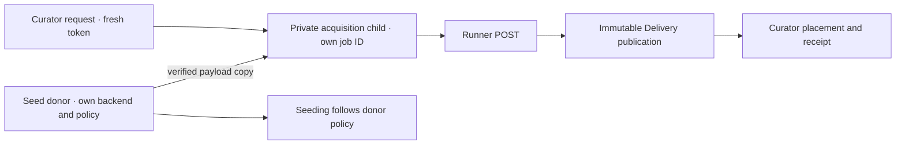

# Using Monarr

A walkthrough of the UI, in the order you'll meet it. Setup reference for
every knob lives in [settings.md](settings.md); deployment and storage
guidance in [deployment.md](deployment.md).

## Household discovery and requests

Sign in with your own Curator account. Members see **Discover**, **Requests** and
**Account**. Search the catalogue or choose a library movie/show for related
titles and movie collections. Library facts are refreshed independently of
provider metadata. “Unknown” means a library check is needed; it never proves
that a file is missing. Recommendations use library membership, not watch
history. Primary-copy presence and acquisition remain separate facts.

Movie requests freeze a title identity. Show requests freeze known aired regular
episodes from the selected seasons; specials, future episodes and unknown dates
are excluded. Joining a matching active request follows the same work. You can
withdraw your own pending interest; other subscribers' interest remains.
After approval, withdrawing interest preserves work already authorized by the
owner. Offloaded scope stays excluded from ordinary monitoring until verified
primary files return. Notes
written by an owner are private to that owner. Members never receive owner paths,
credentials, download controls or administrative/event endpoints.

Local owners open **Requests** to review. A new title needs a destination/profile
and stays unmonitored. Existing titles keep those settings. The review rechecks
primary files and shows present, missing and offloaded counts. Already-present
scope fulfills without a search. Re-acquiring offloaded leaves requires explicit
acknowledgement of the current review. Changed facts, missing volume evidence or
overlapping approvals require another review. Approval does not monitor future
or unrequested episodes.

Approved missing leaves use the existing acquisition/import services and Activity
queue. Admission persists before client submission and resumes after restart.
Uncertain client submissions retain the existing capability-aware retry rules.
Imports reject extra/mixed episodes outside approval and preserve primary files
that arrive after approval. Fulfillment requires verified primary files, never
only a queue completion. Decline/reapproval cannot abandon outstanding transfer
custody. Native owners reach these controls from **More → Household requests**.

Optional Cinema sign-in is configured and linked as described in
[settings.md](settings.md#household-accounts-and-optional-cinema-login). Both apps
keep their own accounts. A Cinema administrator never becomes a Curator owner
through this integration. Use local sign-in for owner work or during a Cinema
outage. The native account page opens the web Account page for explicit linking.

## Recover a local owner password

The host operator can reset an active local owner's password using the existing
data directory. Stop the service first, preserve your normal database backup,
and run the matching Curator binary with the same data directory. Credentials
arrive only on stdin; do not put a password in command arguments or shell history.
For example, using your host's installed Python and Curator binary:

```bash
python3 -c 'import getpass,json; print(json.dumps({"username":getpass.getpass("Owner username: "),"password":getpass.getpass("New password: ")}))' | MONARR_DATA_DIR=/srv/curator monarr accounts reset-password
```

A successful result preserves the account ID and request history, changes the
local password, invalidates that account's sessions and pending invitation
proofs, and queues its Cinema-grant revocations. It never disables household
authentication or turns a member into an owner. Start the service and sign in
locally with the new password. Existing machine API keys are separate credentials;
rotate them in **Access** if a privileged device also needs to be revoked.

## Install & run

With compose (recommended — your customized compose file is gitignored,
pulls never touch it):

```sh
git clone https://github.com/pjunod/monarr.git && cd monarr/deploy
cp docker-compose.example.yml docker-compose.yml   # yours to edit
cp .env.example .env                               # optional: paths + user
docker compose up -d --build
```

Or plain Docker, from the repo root (the build context is the repo; the
Dockerfile lives in `deploy/`):

```sh
docker build -f deploy/Dockerfile -t monarr .
docker run -d --name monarr -p 7676:7676 --user 1000:1000 \
  -v /srv/monarr:/data -v /srv/pool:/pool monarr
docker run -d --name monarr-discovery --restart unless-stopped \
  --network host monarr advertise --name monarr --port 7676
```

The standard image bundles the embedding executable and Cinema's Jellyfin
FFmpeg 8 package, including `ffprobe`, `ffmpeg` and their shared libraries. Build checks execute both media tools in the
actual distroless base. Native MKV/MP4 inspection remains in-process; other
formats can use the bundled probe without a custom image.

`/data` holds the database and backups; `/pool` holds your media library
*and* your download client's completed folder — the mount rules and a
worked pool layout are in the README's Docker section. After code updates:
`docker compose up -d --build` again (it rebuilds and swaps the container
only when the image changed). The tracked Compose template includes a
host-network `monarr-discovery` companion because multicast DNS cannot leave a
normal Docker bridge; the companion advertises port `7676` and does not read
the database or proxy traffic.

## First run

Open `http://<host>:7676`. Three things make the app functional, all under
**Settings**:

1. **TMDB API key** — free from
   [themoviedb.org](https://www.themoviedb.org/settings/api) (a v3 key or a
   v4 read-access token both work). Powers movie/series search and metadata.
   Books need no key — Open Library is keyless.
2. **Root folders** — where your library lives, e.g. `/pool/media/movies`.
   Add one per collection type. A healthy root shows green with free space.
3. **An indexer and a download client** — see
   [settings.md](settings.md#indexers). Use the **Test** buttons before
   adding.

The **System** page shows health checks; anything missing from the list
above appears there as a warning.

## Layouts and color schemes

Open **Display** at the bottom of the desktop navigation, or in **More** on a
phone. Layout, color scheme, and room brightness are separate choices: switch
one without losing the other two. **Classic** is the pre-existing Monarr
layout and the default, **Plex** is the stronger media rail, and **Theater**
uses a wide top navigation deck. The color catalogue matches plurx: Classic,
Terminal, noirr, Amber, Giallo, Silver, Void, VHS, Paper, and Tide, each with
light and dark appearances where the design supports both. Void and VHS stay
dark by design.

The choice is remembered per browser. Switching layouts restyles the current
page in place, so open forms, fetched data, and the current route remain where
they were.

## Adding media

### Describing a series or finding similar shows

On **Add media → Series**, choose **Describe what you want**, enter a
description such as `gay-themed series, no teen dramas`, and click **Find
series**. Applied theme, genre, original language, years, central-theme
requirement, teen exclusion, and library visibility remain visible and
editable. Supported themes are gay male, lesbian, LGBTQ+, coming of age,
found family, political drama, and space exploration. Multiple themes or
unsupported exclusions ask for refinement.

**More like this** on a title starts a fresh seed search. On a recommendation
it keeps the active description and filters. **Remove seed** keeps those
filters. **Title search** returns to ordinary title lookup. A description is
sent in a POST body and never added to the browser URL or persistent storage.

**Why this matches** identifies the provider field and fetch date supporting
each result. Required themes need explicit metadata evidence; local similarity
cannot establish a theme. **Central theme only** requires main-story synopsis
evidence. **Exclude known teen-focused stories** removes known teen/Kids
focus; unclassified shows may remain. Sparse metadata can yield few results.

The catalog search checks a bounded candidate set. Metadata ordering works
without a model. Enable optional local ranking in
[settings](settings.md#local-semantic-ranking-optional) for description and
seed similarity. Provider suggestions and unavailable similarity are labeled.
Preview and Add use the normal library workflow. Known owned titles can be
hidden; unknown ownership remains visible, and conflicting identities cannot
be added from these suggestions.

### Adding a named title

**+ Add media** (Library page) → pick Movie / Series / Ebook / Audiobook →
type a title. Movies and series search TMDB; books search Open Library and
show the author next to each result. Pick a root folder, a quality profile
(or leave the default — the picker names it, e.g. "Default — 1080p", and
you set it under Settings → Quality profiles), monitoring state, and
whether to **Search on add** (on by default: the best accepted release is
grabbed automatically right after adding, Sonarr-style). Hit **Add**.
The Add action stays disabled until a root that accepts that media kind is
available. The API also refuses search-on-add without a root, and every grab
checks the destination again before it contacts a download client. This is
why a missing setting cannot turn into a completed download that only then
fails with `item has no library folder assigned`.

**View details before adding.** Select a result's poster, title, synopsis,
or **View details**. The web UI opens a side drawer on desktop and a full
screen on phones. Read the complete synopsis, available genres, runtime
(per episode for series), and provider status. IMDb, TMDB, TVDB, and Open
Library links appear only when a known database ID is available and open
in another tab. Escape, the backdrop, Close, or browser Back returns to the
same search. Add options in the drawer share the page's root, profile,
monitoring, and search-on-add choices. Quick **Add** remains separate.

Native mobile labels the preview action **Read full synopsis** in Discover
and search. Opening it does not add anything. **Continue
to add** opens the existing options in the same modal; Back returns to the
preview with those choices intact. Quick **Add** skips the preview step,
but still shows the complete synopsis above the options before the final Add.
After a successful native add, the app opens the library item.

A provider outage leaves the original search information available with
Retry. Previewing never adds an item or changes the original Add identity.
Known library items offer **Open in library**; book ownership is specific
to the selected edition. Conflicting identities disable Add and Open until
resolved, while ambiguous local ownership retains readable metadata and
verified links. Previews are always available; there is no feature switch.

**Adding several things is one screen.** Adding does not navigate away:
the row turns into *added* with an **Open** link, a strip at the top keeps
a running list of everything added this visit, and your search text, tab,
root folder and profile all stay put. The next title is one click, and
**Go to library** takes you out when you're done.

- *Movies* arrive hydrated with year, overview, poster, runtime.
- *Series* arrive with every season and episode; specials (season 0) start
  unmonitored, like upstream.
- *Ebooks and audiobooks* share Open Library metadata (author,
  first-publish year, ISBN) but have independent defaults and same-family
  profile pickers. Audiobook searches use audiobook indexer categories and
  support MP3, WMA, AAC, OGG, Opus, M4A, M4B, FLAC, and WAV.

Choosing Ebook or Audiobook adds that edition, not a quality label. If the
same Open Library work already has the other edition, **Add ebook** or **Add
audiobook** attaches the missing edition to the existing book. The result row
names the editions already in the library instead of disabling both choices.
You can also add the missing edition from the book detail page.

Nothing touches the disk at add time — the item's folder is created on
first import.

**Every item gets a folder of its own.** The folder is `Title (Year)`
(`Author/Title` for books) — unless another library item already holds that
name, which happens whenever two different works share a title and a year
(there are two films called *Leviticus* from 2022). The second one is then
given `Leviticus (2022) {tmdb-…}`: the same name plus its provider id, in the
form Plex and Radarr use. Both stay in the library, each with its own files.
Choosing a folder by hand that another item already holds is refused with the
holder's name, rather than silently sharing it (ADR 0020). Adoption reads the
`{tmdb-…}` / `[tmdbid-…]` hint back, so a disambiguated folder is matched to
exactly the film it names.

Upgrading to 0.28.1 repairs libraries where this already happened: for each
folder claimed twice, the item that owns the files keeps it and the other is
pointed at its own `{tmdb-…}` folder. Only the library record changes;
nothing on disk is moved, and the `library-folders` warning under
**System → Health** clears.

## Discover

Discover opens **For your library** on web and native. Choose a movie or show
with a TMDB identity. Search and page through library titles, then see related
TMDB titles, verified movie collection entries, or the selected show's regular
seasons still to review. These suggestions use catalogue metadata, not viewing
history. **Browse all** retains the existing provider lists.

Availability separates **in Curator** from **available in the primary copy**.
The shared status appears in search, discovery, recommendations and title
details. Available means a successful manifest check at the shown time; it does
not promise playback. Show counts cover known aired regular episodes only.
Specials and future episodes are excluded. Missing episode dates or unlinked
files leave coverage unknown. Additional copies do not silently complete the
primary copy. Offload intent and active acquisition remain separate facts.

Library checks expire after 13 hours against the normal 12-hour scan schedule.
After an import, metadata edit, failed check or volume change, status may be
unknown until **Settings → Library → Scan disk** succeeds. Unknown status blocks
a duplicate Add; refresh the check or open the existing title. An untracked
provider title says **Not in Curator**, rather than claiming files are missing.
**Still to get** includes partial, offloaded and unknown entries; **Available in
library** requires verified primary presence.

**Review Season N** opens that season's existing controls on web. Native opens
the show in the library. Review monitoring and searches there; opening a shelf
or following a review link never starts acquisition. Related shelves show up to
30 titles from the first TMDB recommendation page. Collection shelves verify
membership and omit available primary copies. Each provider shelf reports its
own refresh failure; a provider outage does not prove library absence.


**Discover** (sidebar) is for the other half of the problem: adding
something when you do not already know its name. It is rows of posters —
*Trending this week*, *In theaters now*, *Coming soon*, *Popular*, *Top
rated*, *On the air* — read live from your metadata providers. Click a
poster for the overview and an **Add to library** button carrying the same
root folder / profile / monitor controls the Add page has.

The native add sheet preselects the first root folder that accepts the title's
media kind. You can choose another compatible root, but you cannot add the
title until one is selected; there is no implied server-default root because
an omitted destination would leave the item with nowhere to import downloads.

**How to read a row.** Every row carries one line saying what it actually
measures, because the words do not mean the same thing everywhere: TMDB's
*trending* counts how many people looked a title up this week, Trakt's
counts how many have it **playing right now**. A title already in your
library is marked *in library* on the card and offers a link to it instead
of an Add button.

**Nine rows come free**, off the TMDB key the library already needs. A free
[Trakt client id](settings.md#trakt-client-id-optional) adds five more that
TMDB cannot answer — being watched right now (movies and shows), most
anticipated (movies and shows), and last weekend's box office. The **All /
Movies / Shows** tabs filter which rows are on screen. Books have no row:
Open Library has no popularity data worth showing.

**Dekkoo.** Two more poster rows, **Gay movies on Dekkoo** and **Gay shows on
Dekkoo**, appear alongside TMDB and Trakt. They use the same **All / Movies /
Shows** filters, poster-size control, preview, library badges, and **Add to
library** dialog. There is no separate Dekkoo tab or manual title-search step.

Both rows draw from one combined feed of Gay Movies, Gay Series, Gay Romance,
Gay Comedy and Gay Short Films. Only articles belonging to at least one of
those categories contribute titles; broader LGBTQ+, news, horror and drama
categories are not independent sources. Catalog links and collection headings
supply individual titles; TMDB supplies verified identities, posters and
summaries. Duplicate media appear once, in recent-article order. Unmatched or
ambiguous titles are omitted, so the rows are a recent editorial selection,
not Dekkoo's complete streaming catalog. RSS publication dates are never used
as film release years.

No Dekkoo account or additional API key is needed: the existing TMDB key
resolves both rows. Nothing is added automatically. Rows load on demand and
use Discover's 30-minute cache and up-to-24-hour fallback on upstream failure.
The same lists are available to clients using the standard Discover API.

**Poster size** is the labelled **S / M / L** control in the page head, on
both Discover and the Library page. It is one preference — set it in either place
and the other follows — remembered in the browser, so it is per-device rather
than per-account. **M** is what both pages were before the control existed, so
leaving it alone changes nothing.

**What it costs:** nothing while you are not looking at it. Rows fetch only
as you scroll to them, are cached for 30 minutes, and no background job
runs. If a provider is briefly unreachable a row keeps showing its last
contents for up to a day rather than going blank; past that the error is
shown, because by then the row would be wrong rather than merely stale.

Discover never adds anything by itself. For that, see
[Import lists](settings.md#import-lists) — same kind of data, opposite job.

## Native iOS and Android app

Monarr's native companion connects to the server you already run; it does not
run the automation engine on the phone. On first launch, it immediately
searches the current Wi-Fi network and puts each verified server at the top of
the connection screen. QR and manual setup stay visible while that search runs:

1. **Automatic Wi-Fi discovery** browses the local DNS-SD service
   (`_monarr._tcp`). It uses the addresses and port announced by the server,
   including IPv4 and IPv6; it does not guess a subnet or scan an address
   range. Results appear as soon as they answer; **Search again** repeats the
   five-second browse when network conditions change.
2. **Scan pairing QR** reads the code shown by **Access → Mobile pairing →
   Show pairing QR**. You do not have to reveal the raw API key first. Enter
   an address the phone can reach before showing the code. The QR transfers
   that address and the API key.
3. **Enter it manually** accepts a LAN IP/hostname, a VPN address such as
   Tailscale, or an HTTPS reverse proxy. `localhost` means the phone itself. A
   bare direct host automatically uses Monarr's default port, `7676`; explicit
   ports and HTTPS reverse-proxy URLs are preserved. Put literal IPv6
   addresses in brackets when a port is present, for example
   `http://[fd12:3456::20]:7676`.

DNS-SD stays inside the network's multicast domain. Guest Wi-Fi, isolated
VLANs, and some VPNs can prevent advertisements from reaching the phone even
when the server itself is reachable. Docker installs must run the
host-network `monarr-discovery` companion included in the v0.18.5 Compose
template; a copied `docker-compose.yml` is gitignored, so add that service to
older copies yourself. Use the QR or manual address when multicast domains are
deliberately separated.

The app covers the daily mobile loop: browse and filter the library; inspect a
title; edit its monitoring, quality profile, inherited or per-item download
priority, root folder, and path; change season monitoring; and start a search.
**Search now** is the auto search: the best accepted release is grabbed in
the background. **Interactive search** is the same override the web offers —
every release the indexers returned, rejected ones included with their
reasons, a **Would be grabbed** view that narrows the list without gating
anything, and **Grab** on any row. Movies and books search the item (each
book edition and each quality copy has its own **Search**). On a series
there is no whole-series scope: **Interactive search** opens on the first
real season's pack, **Search pack** on a season row opens on that pack, a
copy's **Search** opens on the first season for that copy, and the season
and episode chips at the top of the search re-run it for another pack or a
single episode. A rejected release asks once before it is grabbed. An
incomplete result — one indexer slow or down — is labelled as such rather
than presented as the whole picture.
Movies and series can also keep
additional quality copies, each with its own name, profile, location, and
monitoring state. Copy removal keeps every file already on disk. Discover,
Wanted, downloads/imports, the calendar, and server health are native too.
**More → Open web interface** hands off to the browser for defining profiles
and root folders, configuring indexers, clients, and notifiers, or managing
login, pairing, and API keys under Access.

**More → Display** keeps four independent preferences on this device.
**Layout** offers Classic, Plex, and Theater; Classic preserves the previous
native navigation, Plex emphasizes the bottom bar on phones and pins a rail on
tablets, and Theater moves navigation into a top deck. **Color scheme** offers
the same ten schemes as the web UI. **Appearance** defaults to Auto, follows
the device's light or dark setting, and uses dark when the device reports no
preference; Void and VHS stay dark. **Item size** changes Library tiles and
Discover results between Small, Medium, and Large, with Medium preserving the
previous density.

The API key is stored in iOS Keychain or Android Keystore. Plain `http://` is
supported because many Monarr servers live only on a trusted LAN, but it does
not encrypt the key in transit. The pairing QR also contains the key, so show
it only to a trusted device. Use HTTPS or a trusted VPN outside that LAN.
Development, real-device testing, and store build commands live in the
[mobile app guide](../mobile/README.md).

## PWA fallback (install the web UI)

The UI is a PWA: open `http://<host>:7676` on your phone and install it —
**iOS Safari**: Share → *Add to Home Screen*; **Android Chrome**: menu →
*Add to Home screen* (or the install prompt). It launches full-screen
with its own icon, and below tablet width the whole app switches to a
phone layout: bottom tabs for Library / Wanted / Calendar / Activity,
with a **More** sheet holding Dashboard, System, Settings, Add, the
global search, and the Display controls. The selected Plex and Theater
layouts also adapt the phone navigation. The calendar becomes the agenda —
the same rich list the desktop view offers, full width: poster, episode,
air time, network, status. Wide tables scroll sideways, posters run three
across. Posters are
cached for snappy loads; live data always comes from the server, so
offline you get the shell and an error rather than stale numbers. New
Monarr builds update the installed app on the next launch.

## The library page

The **All** tab shows everything, grouped into Movies / TV / Ebooks /
Audiobooks (never interleaved); those tabs show flat grids. **Each
section carries its own controls** in its header bar: a title/author
text filter, a state filter (monitored, unmonitored, missing,
incomplete, complete), **On disk · Offloaded · Everything** (default
Everything; see [Offload](#offload-free-the-space-keep-the-title)), and a sort (title, year, recently added, rating —
books also sort by author) with an ascending/descending toggle. The same
per-section settings drive that section's flat tab, and everything but the
text filter is remembered per browser. Every card carries the rating star,
the color-coded completeness pill, and a ↓ badge while something is
downloading for it.

A work with both editions appears in both the Ebook and Audiobook sections,
with one shared detail page. The All count still counts the work once; the
edition tabs count the editions they contain.

**Poster size** (S / M / L) in the page head — smaller to fit more of a
large library on one screen, larger for the artwork. It is the same
preference [Discover](#discover) uses, so the two pages never disagree about
how big a poster is, and **M** is the size everything was before the control
existed.

## Adopting an existing library

Monarr expects humans to touch the filesystem. Point a root folder at your
existing collection and run **Scan disk** (Library page):

- Files inside known item folders are linked (episodes matched by
  `S01E02`-style names; book formats read from the extension).
- Every video file is **measured**: monarr reads the container headers and
  records resolution, codec, bit depth, HDR format, audio tracks and
  bitrate. A file called `A Good Day to Die Hard.mkv` gets a real quality,
  because the bytes were always there to answer the question (ADR 0013).
  Measuring is queued per file, so a large library fills in over the
  minutes after the scan rather than blocking it.
- Folders nobody claims are listed as **unmatched**, each with a
  **Match…** button that pre-fills the add search.
- Unavailable folders are reported only for entries with recorded media.
  Titles awaiting their first download are not problems. File records are
  retained while a whole folder is unavailable, preserving the evidence for
  repair; individual vanished files in readable folders are pruned.
- In **Settings → Disk scan → Folders needing attention**, choose **Repair
  folders…** to reconnect moved folders, then **Apply all repairs** to scan
  every entered location. Restore inaccessible drives and use **Check again**.
  See [folder repair](settings.md#disk-scan--repairing-folders-with-recorded-media)
  for validation rules and recovery when the files themselves are gone.

The button opens a **Disk scan** window immediately and changes to
**Scanning…**. The window shows whether the scan is queued, running, waiting
to retry, complete, or failed. Completion refreshes the library and folder
review counts and shows the numbers of items scanned, files linked, and files
removed. Close the window to keep using the app; **Scanning…** reopens the
active scan without queueing another. You can leave the page and return to
check it because its status is saved with the job. Matching unmatched folders
and measuring files continue as separate jobs.

Scans also run on a 12-hour schedule.

Ad-hoc requests take priority over scheduled queue work. One worker is reserved
for these requests, in addition to the two general workers, so long-running
background jobs cannot occupy every slot. Requesting an already queued scan
promotes that job without creating a duplicate. Reopen **Scanning…** to
promote an unstarted scan queued before this update. Running jobs finish normally;
retry backoff, provider quota deadlines, and file-access routing still apply.

## Monitoring seasons and episodes

On a series page, each season row carries a checkbox. Unticking it stops
monarr wanting that season and cascades to every episode in it; each episode
has its own checkbox for finer control. The season name toggles the episode
table open and closed, and neither control interferes with the other.

## Getting releases

### Find by external ID

The Add search accepts ordinary text plus exact `tmdb:<digits>`,
`tvdb:<digits>`, `imdb:tt<digits>`, or a bare IMDb title ID. Exact input is
validated strictly and resolves one provider record rather than falling back
to a similarly named title. If a provider returns conflicting IDs, Monarr
shows an identity-conflict error and does not add or merge the result.

On a movie or series detail page, **Identity** lists the canonical title,
external IDs, aliases, country evidence, and provider snapshot health. Use
**Refresh identity** after correcting provider data, or add a manual alias for
a real release spelling. Manual aliases are evidence; they do not change
episode numbering. **Alternate names** is collapsible and shows the name count;
lists with more than three names start collapsed. Lists of one to three names
start expanded. Expand the list to inspect provider details or remove a manual
alias. The add-alias form stays visible when the list is collapsed.

Automatic is the default posture — the interactive search is the override
for when you want to pick a specific release yourself.

**Automatic** — three entry points, all using the decision engine (the
profile's target and floor, upgrade rules, custom-format scores) to pick
the best accepted release with no list to review. Once chosen, the profile's
download priority or the item's override travels with the grab to nzbd:

- **Search on add** (checkbox on the add form, on by default) fires the
  moment an item is added.
- **Changing an item's quality profile** fires one too. Asking for a
  different target is a request, not a note — without this the item joined
  the wanted list and waited up to twelve hours for the backlog loop.
- **Auto search** (button on every detail page) does the same on demand —
  for series it tries a pack when every episode is aired, selected, and
  still wanted, then searches individual episodes if no pack was grabbed.
  Ongoing or partially selected seasons search wanted aired episodes directly.
  Active downloads suppress overlapping searches for that copy.
  Pressing the button is a manual search: it is charged to the indexer's
  interactive request allowance when a positive cap is configured. A cap of
  **0 means unlimited** for manual and automatic searches; provider retry
  delays still apply. With a positive cap, manual searches avoid the rationed
  automatic allowance, so a busy backlog cannot make it a no-op. For a series the queued season comparison
  is marked manual too. It does not wait behind an unattended comparison
  parked on the automatic allowance, pressing again promotes one that was
  parked, and the week-long cooldown that spaces out unattended comparisons
  does not apply; only a repeat within ten minutes of your own completed
  comparison is declined, and the result says so. A Wanted search for one
  title or one target is manual in the same way. **Search all** and
  whole-reason runs are the backlog on demand and stay on the automatic
  allowance. In every Wanted run, a target no indexer could be searched for
  is reported as skipped (indexers unavailable) with the reason, not as
  searched with nothing seen. If an indexer still could not be
  searched — allowance spent, provider retry delay, timeout — the result says
  which indexer, why, and when to retry, instead of "No releases came back".
- The **Wanted** page groups every title once, with its missing episodes,
  copies, or editions underneath. **Search all now** snapshots every eligible
  target across every title and page. Counted Missing and Upgrade actions do
  the same for one reason; a group action stays inside that title and the
  selected reason; a child action searches only that episode, copy, or
  edition.

**Interactive search** — **Interactive search** on movie detail pages and a
separate **Search** action on each book edition; on a series, each season has
**Search pack** and each episode a **Search** button. In the web UI,
search opens in a dialog inside the current viewport, including when launched
from an episode far down the page. The title and **Close** stay visible while
results scroll; **Escape** closes it and focus returns to the button you used.
Paging reveals the new results, and grab confirmations or errors are brought
into view. The detail page's **Edit** form and the settings' **New profile** and
**Edit profile** forms use the same dialog behavior.
The native app has the same search (see [Native iOS and Android app](#native-ios-and-android-app)). Every release the
indexers returned is shown — including rejected
ones, with the reason attached (`above target`, `below floor`,
`not an upgrade`, `target met`, `language not wanted`, `does not match …`).
A release advertising audio in anything other than plain English shows
what it advertises under its quality (`German`, `MULTi`). **Grab** sends
your pick to the right client, with no decision gate — interactive search
is the override, and it always wins.

**The loops** — anything monitored and missing (or below its profile
target, or in a language the profile does not accept) stays on the wanted
list, and two loops work it unattended:

- **RSS sync** (every ~15 min): pulls each indexer's newest releases and
  grabs whatever matches a wanted item and passes the decision engine.
- **Backlog search** (every 12 h, or run `backlog.search` from the System
  page): actively searches for wanted items and grabs the single best
  accepted release each.

Failed downloads (client-reported failures or import errors) are
**blocklisted** — never grabbed again — and a replacement search fires
immediately.

## The item page

Click anything in the library to get its page. The fact grid answers the
usual questions at a glance:

- **Location** — the item's folder as a highlighted path chip (assigned
  at add time; created on first import).
- **Status** — monitored/unmonitored, a color-coded completeness pill
  (green = everything wanted is on disk, yellow = partial, red =
  nothing; series count monitored episodes aired to date), and a
  **↓ downloading** pill whenever a grab for this item is in flight.
- **Profile** — the quality profile driving grabs and upgrades.
- **Quality** — what is on disk against the profile: `at or above …`,
  `upgrading to …`, or — when the profile requires an audio language the
  file was measured not to carry — `upgrading · no English audio on disk
  (German only)`. The measured-facts pill beside it names each file's
  languages (ADR 0022).
- **Download priority** — the effective level nzbd receives, plus whether it
  comes from the profile or is an item override.
- **Ratings** — labeled chips per source: TMDB (/10) for movies & series
  and Open Library (/5) for books come free; add an OMDb key (Settings →
  Metadata → Extra ratings) and Rotten Tomatoes, IMDb, and Metacritic
  appear alongside. Percent sources render as percentages.
- **Links** — IMDb / TMDB / TVDB / Open Library pages, opening in a new
  tab.

### Where it stands — the status panel

Directly under the title block, above Identity, every item shows where it
stands from search to cinema, in six stages left to right (stacked on a
phone): **Searched**, **Downloading**, **Processed**, **Moved**, **Cinema
notified**, **In cinema**. Each stage has its state (✓ done, ● in progress,
◷ waiting, ✕ failed, ○ not yet), when it happened, and one line of detail.

- **Searched** names the last search and who ran it — `manual` (you pressed
  a button), `automatic` (the backlog, auto search on add), `wanted` (a Wanted
  run), `replacement` (a re-grab after a failure), `rss`, `interactive` (you
  picked a release) or a season comparison — with what it saw: `11 seen, 0
  accepted`, and the reason most releases were refused, or why it did not
  search at all (`downloading`, `unmonitored`, `indexers unavailable`).
  Curator keeps the newest 20 searches per movie or episode.
- **Downloading** shows the percentage and Runner's own speed and time left;
  Curator does not average or guess. Before Runner starts it the stage says
  `queued in Runner` — Runner has no queue position to report.
- **Processed** is Runner's post-processing stage (`verifying`,
  `repairing`, `unpacking`) and since when, or the failure Runner reported.
- **Moved** counts the files placed into the library, or says the import is
  waiting or failed.
- **Cinema notified** and **In cinema** come from the cinema read-back:
  `scan accepted`, then `confirmed` at the time cinema confirmed every file
  with matching size and modification time, or what cinema says it is
  waiting on (a full scan, its queue). Each episode of a season pack gets
  its own answer.

The headline says the current stage in a sentence. Below it are the live
download numbers, any earlier attempts (a failed grab, a cancelled one), and
the actions that apply: **Search now**, **Interactive search**, **Open in
Activity**, **Cancel download** (asks first, then cancels in Runner and
blocklists that release so the next automatic search does not grab it straight
back; Activity's Remove stays a plain removal, and you can still pick the
release yourself from interactive search),
**Retry import**, **Send to cinema again**, and **Ask cinema to confirm**,
which sends a scan request naming the item's current files so cinema's
answer confirms them — the way to check an item imported before this record
existed; asking again refreshes the same request rather than adding one.
Every action shows its result in the panel. Once something is on disk, a later
search that finds nothing (or is skipped) shows as detail on **Searched**, not
as a step backwards, and a failed upgrade grab is listed under earlier attempts
while the panel keeps showing the file you have.

The panel refreshes every 2 seconds while a download is moving and every 30
seconds otherwise, without moving your scroll position or focus. It never
hides: once everything is done it collapses to one line (`In cinema,
confirmed Sep 4`) that opens again on a click. A series shows one line per
season (`2 of 6 in cinema · 4 in one season pack`), with a season pack's
download shown once on the season (the counts cover monitored episodes that
have aired, plus any with a file); open a season for a six-segment strip per
episode, and click an episode for its full track and its own actions —
**Search now** searches that episode only, and **Retry import**, **Send to
cinema again** and **Ask cinema to confirm** act on that episode's download and
files. The panel follows the primary copy; additional quality copies and book
editions have their own rows in Activity. The phone app shows the
same panel from the same endpoint (`GET /library/{id}/status`).

**Seasons** and **Files** start collapsed and show their totals in the section
header. Expand Seasons to use the existing season/episode monitoring and search
controls. Each section keeps your choice while the item refreshes; visiting
another item starts its sections collapsed again.

Actions up top:

- **Auto search** — grab the best accepted release automatically.
- **Interactive search** (movies/books; per-episode and per-season on
  series) — the full candidate list with scores and rejection reasons.
  Release titles link to the release's page on the indexer (new tab).
- **Re-measure files** — read the files again and record what is actually in
  them. Use it after fixing a permission or a mount that made a probe fail;
  a routine scan skips files it has already measured at the same size.
- **Import file…** — put a file you already have into this item without
  going through Activity. See [Import file… from the item page](#import-file-from-the-item-page).
- **Re-match…** — the item was matched to the wrong title (a folder adopted
  as *Dune (1984)* that is *Dune (2021)*): move its files to the right one.
  **Move to…** on a file in the Files panel does the same for one file, for
  example an episode filed under the wrong episode. See
  [Re-match and Move to…](#re-match-and-move-to).
- **Edit** — change monitoring, quality profile, download priority, root
  folder, or the folder path itself. Choose **Profile default** to inherit,
  or one of six explicit levels from Very low through Force. Changing the
  root recomputes the folder from the naming rules; **files on disk are never
  moved** by an edit.
- **Refresh metadata** — re-fetch from the provider right now: new
  episodes for a continuing series, updated poster/status/rating. The
  `metadata.refresh` task does this for the whole library every 12 h
  (run it once from System → Tasks after upgrading to backfill ratings).

Book lookups pace Open Library requests at one per second and retry
connection resets, interrupted responses, timeouts, and temporary server
errors up to three attempts. Retries wait 1 then 2 seconds, or longer when
Open Library sends `Retry-After`. A requested wait over 30 seconds stops
that lookup instead of holding up the library refresh. Permanent errors
such as a missing work (404) are not retried. Failed work lookups leave the
book's existing metadata intact; the scheduled task continues with other
items and reports its first failure. Use **Run now** to retry after the
provider recovers.

The same completeness pill, rating, and ↓ badge appear on every library
card, so the grid shows at a glance what's complete, what's partial, and
what's moving right now.

### Import file… from the item page

The target is already known on an item page, so importing a file you have
is: **Import file…**, browse, pick, confirm. The same button is on the
item screen of the iOS and Android app.

**1 · Choose files.** The browser opens at the completed-download folder.
Shortcuts take you to this item's own folder and to each library root; the
path box opens any other folder. Folders come from the server's filesystem
browser; the files listed are the media directly in the current folder (not
in its sub-folders), each with its size, the episode its name says (or *no
episode in name*), its quality, how many subtitles travel with it, and
*runner delivery* when it is part of a Runner publication. An entry Curator
cannot import (a symlink, an unreadable file) is listed with the reason
instead of being left out. A folder Curator
cannot read says so by path and names the fix: when the download client
sees that folder under a different path, add a remote path mapping to the
client in Settings → Acquisition.

**2 · Confirm.** One line per file:

- **Episode** (series) — prefilled from the name. A file whose name has no
  episode (an obfuscated `a7f3c91e.mkv`) must be given one before Import
  is offered. Your choice is stored with the import's file selection, by
  path, so a retry places the file as the same episode whatever its name.
- **Copy / Edition** — shown when the item has quality copies or book
  editions.
- **Destination** — the exact library path from the naming template.
- **What happens to what is there** — *new file*; *replaces …* when the new
  file ranks higher in the item's profile (the old one is removed once the
  new one is placed); or *kept beside …* when it does not.
- **How it gets there** — for a runner delivery: placed through an approved import, and
  Curator cleans up the delivery folder under its usual rules (there is no
  delete option). All the files you pick from one delivery are placed
  together, in one import. A delivery grabbed for another title is moved to
  this item when you place it — the confirm step says so — but only while
  none of it is in the library yet; once any file of it has been placed
  there, the confirm step refuses the move. Your choice holds for every
  later attempt of that delivery, after a failure or a restart too. For loose files: hardlinked (your copy stays) on the same
  volume, copied across volumes. Tick **Remove original** (off by default)
  to rename instead on the same volume, or copy, verify and remove the
  original across volumes. Remove original is refused for runner
  deliveries, for files the library tracks, and for anything inside a
  library item's folder. An original is removed only while it is still the
  file you chose (same file, size and modification time) and its library
  copy is the same file (a hard link) or the same bytes (a copy); otherwise
  it is kept and the dialog and the Activity trace say why. The removal is
  recorded before the import completes, so a restart finishes it.

Subtitles beside a video, in a `Subs/` folder, or in `Subs/<video name>/`
travel with it, named after the library file
(`<name>.<lang>[.forced][.sdh].srt`) by the same rules as a runner
delivery's subtitles. Beside the video, only a subtitle whose name starts
with the video's name travels (a downloads folder holds other releases'
subtitles too). A subtitle never overwrites a file Curator did not place;
it takes the next free name. Subtitles placed by an Import file… of loose
files are not removed when that video is later upgraded or replaced
(runner deliveries' subtitles are); delete them by hand if they no longer
fit.

**Started.** The dialog lists each job it started with its Activity row,
followed until it finishes: its state, why it failed if it did, and what
Remove original removed or kept. A long copy shows **Stop** (the import's
own cancellation: the source stays where it was, and the row can be
retried from Activity).

### Re-match and Move to…

Two shapes of a wrong match, one operation: **move these files to the right
item or episode**, adding that item to the library if it is not there
(ADR 0027).

- **Re-match…** (item page, beside Import file…) moves all of the item's
  files. Search for the right title: titles already in your library are
  listed first (that is how you reach a manual entry), then the provider's,
  which are added to the library (default profile, a root of that kind) when
  you move. For a series every file keeps its episode numbers in the new
  series; a file whose episode the new series lacks needs a pick.
- **Move to…** (a file's row in the Files panel) moves one file: on a series,
  *Same show, different episode* or *A different show*. On the phone app the
  Re-match sheet does both: *All files* or one file.

While a move runs, **Where it stands** on both items (the one the files
leave and the one they go to) shows a **Moving files** block: the direction
("Files moving here from Dune (1984)"), state, files and bytes done, each
`from → to`, what cinema said (including files it still has or kept) and
**Stop** until the files are committed. It refreshes every 2 s without
moving the page; Stop's answer appears beside the button. A move that ends
badly (failed, or complete with files that could not move) stays there for
24 hours with its reason and the files that did not move, until you press
**Dismiss**.

Nothing moves until you have read the preview. It lists:

- every rename, `from → to`, with the target's naming rules. A folder the
  move chooses (a title with no folder on disk yet) always carries the
  provider hint, `Dune (2021) {tmdb-438631}`, so the next scan and cinema
  keep the new match. Subtitles and other files with the video's stem
  travel with it.
- how the bytes get there: a **rename** on one volume; across volumes a
  **copy**, verified (size and SHA-256) and published, then the original
  removed. A file already at a destination is never overwritten: that file
  needs a choice, with a picker on a series.
- files that do not fit, with an episode picker, or *Leave it out*. Until
  every such file is picked or left out, **Move** waits and nothing moves.
  Only a file you leave out leaves the library (it stays on disk). A file
  covering two episodes maps to two episodes, never split.
- what happens to the item the files leave: it **stays** (wanted) if you
  added it or it still has files or downloads; it is **removed** only when
  folder adoption created it and it is now empty, along with its emptied
  folder (anything else in it is left and listed).
- the release that produced each moved file, **blocklisted** for the item it
  left (checkbox, on by default), so automatic search does not grab it for
  that wantable again. Files adopted from disk have no release to blocklist.
- what happens to a file the target already has, by the rule import uses:
  the moved file **replaces** it when it ranks higher in the target's
  profile (and its language is acceptable) — the old file is removed once
  the move is committed — and is **kept beside** it otherwise, with the
  reason.
- what cinema will do: scan the new folder and drop the old entry, or — a
  cinema without removed-path support — scan the new folder only; the old
  entry then stays in cinema until its next reconcile scan.

The preview refuses while either title has a download in flight, an import
running, a replacement open or another move running, and names which;
**Wait for it** previews again (another move offers *Show its progress*
instead). A replacement waiting for a release can hold a title for a long
time and cannot be cancelled; the message says so. A preview that the library has since moved
past is refused when you press Move: preview again.

After **Move**, the dialog shows bytes copied and **Stop**; close it and
reopen **Re-match…** to follow the move again. Stop before the
files are committed puts every moved file back (a copy's partial file is
removed, the original never touched). A restart mid-move resumes from the
journal; a file that changed on disk since the preview is not moved and is
listed for review. A move is finished only when the copied originals and
replaced files are gone; anything that could not be removed (or, after
Stop, put back) is named in the dialog and retried every 30 seconds. A
library scan leaves both titles alone while a move runs. Both items' history show a `rematched` entry with every
path that moved, and the dialog shows *Moved, cinema confirming* until
cinema reports the new files placed and the old paths gone.

## Offload: free the space, keep the title

**Offload…** deletes the files of a movie, a show, one season or one
episode and **keeps the title**: its identity, profile, quality copies,
history and blocklist stay, and so does Cinema's watch history. The scope is
marked **Offloaded**, its own state rather than just *unmonitored*: automatic
search, RSS, upgrades and season discovery never grab it, and ticking
*Monitored* is refused (the box is disabled; **Re-acquire** is offered
instead). Find it on the item page (beside Re-match…), on a season row and on
an episode row (the phone app has the same buttons; its episodes sit under
each season's **Episodes**).

The dialog says exactly what happens before anything is deleted:

- every file, with its sidecars and any untracked subtitle, and what each
  frees. A file another hard link keeps (a seeding copy) frees nothing until
  that link goes too, and says so.
- **bytes freed**, and the library volume's free space before and after.
- a file that covers several episodes takes them all: offloading `S01E02`
  of an `S01E01-E02` file offloads both, and the dialog says it.
- what Cinema will do: keep the title greyed out with **Get it back**, or, if
  its Cinema does not advertise `offload` yet, **drop the title and its watch
  history** (said before, never a gate; upgrade Cinema first to keep them).
- what blocks it: a download, import, re-match or replacement in flight for
  that scope, with **Wait for it**.

**Offload** enables once you tick that the files are deleted, not moved to a
trash. After it the dialog shows files deleted and **Stop**; close it and the
item's **Where it stands** shows an **Offloading files** block (files done,
Stop, Cinema's answer) that ends as *Offloaded 12 Nov 2026 · 38.2 GB freed*
until you **Dismiss** it. A restart mid-way resumes. A share that is not
mounted makes the operation **wait** with that reason and nothing is deleted
until the folder is back; a file that cannot be unlinked is named with its
reason and **retried** every 30 seconds. **Stop** ends the remaining deletes:
what is gone stays gone, and a title that still has a file stops being
offloaded. The item folder is kept so its path stays stable. History records
`offloaded` with the files and bytes.

**Re-acquire** (the item, season or episode, or **Get it back** in Cinema)
clears Offloaded inside that scope, monitors it and searches at its current
profile, a season as a pack first; the answer shows at once and the status
panel follows the grab through to Cinema. A file that lands on an offloaded
season or episode by any route also clears it, and an episode that appears in
an offloaded season arrives offloaded. A season that appears on a show you
offloaded whole arrives **unmonitored**, not offloaded.

The Library's **On disk · Offloaded · Everything** control is remembered per
browser (and per phone), defaults to Everything, and an offloaded card carries
an *offloaded* pill. Cinema's own search always includes offloaded titles. Settings → Connections shows each Cinema notifier’s advertised `offload`
support beside its Test button, including when it was read. This is advisory.

## The Files table, and getting rid of a bad file

Expand **Files** to see 25 files per page. **Files per page** offers 25, 50,
100, 200, 500, or All; the controls above and below the table move between
pages. Changing pages brings the top controls back into view. Removing the
last file on a page returns to the last remaining page. A new item starts on
page one with 25 files per page.

Every file lists what it measures as and **how we know** — measured from the
bytes, taken from the filename, taken from the release name, set by hand, or
unreadable.

There is one more badge, and it is the only one that changes what monarr does:
**does not add up**. It means the file was read and what it says about itself
cannot be true — a 2160p file at 725 kbps, a declared TrueHD track the whole
file has no room for, or a 90-second "movie". The reason prints next to the
path, with the arithmetic.

One of those reasons is worth reading closely, because it tells you where to
go looking. **"The file is cut short"** means the container states its own
finished length and the file on disk is smaller: 500 MB arrived out of a
declared 60 GB. That is not a bad release, it is a transfer that stopped, and
blocklisting it would punish a release that was fine. Check the download
client, the disk, and any size caps.

A cut-short file caught at import is **refused** rather than placed — the one
refusal in the import path, because it is the one case that is proof rather
than judgement. The download is surfaced as failed with the numbers on it and
can be retried once the underlying problem is fixed; the release is not
blocklisted. Placing the stump instead would put the item straight back to
wanted, so the next search would grab, land another stump, and go round again.
You will still see this badge on files that landed before the check existed —
"Re-measure files" re-grades them.

Every other reason means the opposite: the file is complete and is simply not
what it claims. Those are worth blocklisting. The distinction matters because
from every other angle the two are identical — a fake is usually built from a
real release's header, so it has the same tracks, the same chapters and the
same stated runtime. The declared length is the only thing that separates
them. A file in this state stays exactly where it is and
stops counting toward the item being complete, so monarr keeps looking for a
real copy instead of sitting satisfied on a fake one.

This is deliberately different from **unreadable**, which means monarr could
not parse the file at all. Not knowing is a reason to leave a file alone —
replacing something you cannot read means possibly deleting something perfect.
Knowing it is wrong is the opposite.

Two buttons on each row:

- **Delete** — removes the file from disk and from the library. Use it for a
  duplicate, or a copy you simply do not want.
- **Delete & blocklist** — removes the file, tells automation never to grab
  that release again, and starts searching for a replacement. Use it when a
  release turned out to be a fake, a mislabel, or the wrong cut.

The two are separate because they are separate statements: a file deleted to
free space should not poison a release that was fine. **Delete & blocklist**
is disabled for a file monarr did not grab — an adopted file has no source
release, so there is nothing to blocklist, and the button says so rather than
half-working.

## Cleaning up after a download

Cleanup follows the owner of each delivery. For ordinary download clients,
**Clean up after import** controls their normal post-import cleanup. Usenet
clients default on; torrent clients default off because they may still be
seeding. Curator verifies guarded local removal when a client no longer has
the job. This setting never grants deletion authority inside a library root.

Native Runner downloads are cleaned up **per file**, by what became of each
file of the publication (Activity → expand the row). A file leaves when it was
*placed* and the library copy still has exactly its bytes (checked by digest,
never by size), or when it was *discarded* (superseded, a duplicate, a sample,
or discarded by you). *Unresolved* files stay, and so does the folder, until
you **Place**, **Discard** or **Keep** them. Before each deletion Curator
re-checks that the folder is still the same publication, that the file is
still the one its manifest names, and that the download storage is still the
same disk; if the storage changed (an unmounted share), nothing is deleted
and the publication says why. Cleanup runs right after the import and again
every hour. If the library copy changed (for example a different file of the
same size is there now), the publication's file is kept as *unresolved* and
the reason is shown, because it may be the only good copy. If you replaced
the download storage and accepted it, publications that were on the old disk
are held: nothing is deleted from them automatically until you discard their
files yourself. The **Clean up after import** switch does not apply to Runner
publications.

While a cleanup pass runs or waits, the publication in Activity says so and
why (*after its import*, *hourly sweep*) with **Pause cleanup**; a paused
publication is left alone until you **Resume cleanup**. A folder whose
manifest files are all gone but that still holds something Curator did not
put there (a `.DS_Store`) shows **Delete files…** in Download storage to
remove it whole.

*Historical* publications — payloads that existed before v0.39.0, including
the older pre-delivery review backlog — import normally but are never deleted,
automatically or by **Delete selected files…**, until their review batch is
approved (`POST /api/v1/downloads/publications/approve-cleanup` with the
publication ids; the same per-file rule then removes only what has evidence).
A historical folder with no manifest at all is shown as *import failed* with
the reason; once approved, delete it whole from Download storage.

When you retry a held job in Runner, Curator clears its cached hold only after
Runner supplies a newer control revision from the same instance, with the same
cause and stage. This applies to post-processing, storage and missing-tool holds
as well as capacity and quota. A missed release event is recovered from the
current queue or terminal history; an old snapshot or bare SUCCESS never clears
the hold. The existing delivery manifest still controls import and acceptance.
Runner queue and history polls stream status metadata and discard large recovery
records and internal file proofs. A large job record does not truncate the poll;
transport truncation or invalid status metadata remains an explicit error.
Final source checks appear as **Verifying publication**, separately from filename
restoration, so whole-file verification is not reported as rename time.

Older Runner history rows are not adopted or cleaned merely because Runner now
supports delivery receipts: their folders are historical publications, so a
newly observed history row cannot silently authorize deletion.

### Completed folders — accounting survives an empty queue

System → Storage → **Download storage** inventories configured Curator-owned working
trees independently of the queue. The deployed `/working/monarr` root contains
`completed`, also mounted at `/downloads`; both names refer to the same files.
The `completed` container is omitted as a row, while its payloads are listed
individually. Hidden entries, loose files, archives, and nested files count;
symbolic-link targets are not followed. Sizes are **logical bytes**, not
allocated space or a promise of how many bytes deletion would reclaim.

| Explanation | What to do |
|---|---|
| Active | A download or import still owns this path; let it finish |
| Awaiting import | Check Activity for approval, cancellation, or a stalled handoff |
| Failed | Review the failure and use **Choose files to import** to choose a destination |
| Cleanup pending | A cleanup obligation remains; its owning worker retries it |
| Retained | Files remain accounted for and are not eligible for automatic cleanup |
| Untracked / ambiguous | No current record, or multiple associations; review the files and historical receipts |
| Symlink | Target bytes are excluded; check the link separately |

**Scan download storage** queues another scan. **Choose files to import** opens the
shared manual import dialog with that location prefilled; opening it does not import
or delete anything. Untracked entries and legacy history-only associations
are not automatically adopted. Clearing or aging out an Activity row does not
cancel durable receipt, acknowledgement, or cleanup work. The inventory keeps
showing files until a later complete scan confirms their state. Cleanup uses
recorded file identities and current ownership checks; unknown siblings remain
protected. A configured storage root alone does not identify every child as
belonging to one download.

A full download progress bar does not prove a complete payload. PAR repair,
archive extraction, or a disk write can fail after most bytes arrive. A failed
season may contain usable episodes alongside missing or unfinished ones.
Monarr preserves any payload path reported with the failure so these files
remain associated with the failed download and available for manual review.
Native Runner failure details also include its `Failure:Files` explanation
when available, such as a failed move into failed-download storage. These
failures still use the existing blocklist and bounded replacement search;
retained media is not automatically declared complete or imported.

The **Storage entries** list starts collapsed; click its heading to expand or
collapse it. The heading shows the total entry count. Storage totals, scan
status, and deletion progress remain visible while the list is closed. Closing
and reopening the list preserves its filters, page, and selection.

The expanded list defaults to **25 entries per page**. Search paths or download titles,
filter by status, and sort by name or largest first. Names and parent paths wrap
within each row so size, explanation, and actions remain visible on narrow screens.
**Select page** selects eligible entries on the current page; **Select all**
selects all matching eligible entries across pages. Changing the search or status
filter clears selection. Changing pages preserves it.

**Delete selected…** reviews the selected paths, file count, and logical size
before permanent deletion. Each entry is checked independently; the result
reports successful deletions and individual failures. Progress and results survive
navigation within the app and changes between desktop and mobile layouts; keep
the browser tab open until the batch finishes. Confirmation opens in a focused
dialog, including when you select an entry near the bottom of the list.
Entries that change after
selection must be selected again. Active downloads, awaiting imports, storage
containers, and entries from incomplete scans cannot be selected for deletion.
**Choose files to import** remains an individual action because each payload needs a
library destination.

**Delete files…** shows a confirmation for the selected entry. This is an
explicit operator action. Curator rechecks ownership, active work, and the
selected file identities before unlinking through a directory handle. Library
and recovery paths, storage roots, and active download/import paths cannot be
deleted through this action. Removing a symlink removes the link, never its
target.

A scan error retains the last complete inventory and shows the error and its
last successful timestamp. The health check warns on entries needing review,
failed scans, or a snapshot older than 15 minutes. Each root scan is limited
to 100,000 entries; hitting that limit is reported as incomplete, not an empty
folder. Background scans have no fixed 30-second timeout, allowing slow network
storage to finish. They respect shutdown cancellation between filesystem calls;
an unresponsive mount can still delay a call. Scans are serialized so they cannot
accumulate workers. Deletion rechecks only the selected payload under its own
30-second deadline.

A successful client delete response alone does not prove local files
disappeared. Curator checks the recorded path and keeps retry/error state when
the result is uncertain. Runner-owned processing and recovery trees remain
outside Curator's cleanup authority. A reused path is not treated as the old
payload merely because its name matches; accepted generation and file identity
must still match before cleanup.

## The same release, twice

Monarr will not grab a release it already has in flight. The check is at the
moment of the grab — not only in the automation passes that precede it — so
two overlapping passes, an instant re-search after a failure, and the button
in the UI all land on the same answer: the existing download's row, not a
second copy of 90 GB. Titles are compared with the separators folded, because
`True.Lies-HDS` and `True Lies HDS` are one release and indexers disagree
about punctuation.

Nor will automation grab a release whose bytes are **already here**: a
download that arrived, failed to import, and whose payload is still retained
is retried in place, so fetching the identical release again could only
produce the identical failure. Candidate selection passes over that release
and takes a different one if the indexer has it. Removing the download from
Activity, or the payload leaving the disk, makes the release eligible again.
A payload that arrived cut short does not block its release — a fresh grab
may complete it. A manual grab is never refused for this.

Replacement is bounded too. When a download fails, Monarr searches for a
replacement immediately — that is what you want the first time and the second
time. After **three releases' worth of bytes spent on failed grabs for the
same want inside twelve hours** it stops, records `regrab_capped`, and leaves
the item wanted. Five releases of one movie in ten hours is not persistence;
it is a loop with your bandwidth as its budget. The budget counts what was
actually downloaded, not attempts: a post that fails health before any of it
arrives (typically one taken down) costs nothing, so the next post is tried
straight away. A failure whose download size is unknown counts as a whole
release, and so does one whose fetched share nothing measured. "Bytes" means
the share of each release fetched, whatever its size. Failures that cost no
bytes still spend an indexer grab each, so twenty of them inside the window
also stop automatic re-grabs. The cap applies to every automatic search — the RSS sync,
Auto search, the backlog pass and the re-search after a failure. A manual
grab is never capped.

## Interactive search

Every candidate is listed, including the ones monarr would decline, each with
its reasons — "found nothing" and "found two hundred and disliked all of them"
are different problems. A rejected release can still be grabbed by hand;
manual grabs are never gated.

Because a busy indexer returns hundreds of rows, the list pages (50 at a time
by default), filters by name, and offers a **Would be grabbed** view. Each
row's rejections collapse to the first reason with the rest one click away.

In a phone browser or installed PWA, each result stacks its release name,
labeled metadata, rejection details, and **Grab** action within the screen.
Pagination wraps to fit. Wider screens keep the column view, with horizontal
scrolling inside the results when the panel is too narrow for the table.

A release can also carry an amber **⚠ warning**: the profile would take it,
but its advertised size cannot hold what its name claims — a "2160p Remux"
listed at 500 MB. That is a caution for you, not a refusal. Unattended
searches (RSS and backlog) do decline these outright, because nobody is there
to weigh it and the cost of guessing wrong is a fake file that ends the hunt.

Release Search explains the identity decision for every row: matched external
ID, canonical title, alias, country convention, or the exact conflict that
rejected it. The accepted explanation is stored with the grab and remains
visible on its Activity row.

The native app runs the same search against the same endpoint and shows the
same rows — the list scrolls instead of paging, and a rejected release asks
once before **Grab anyway** sends it. The one thing the phone leaves out is
the custom-format list behind the score, which the browser shows as a
tooltip.

## Monitoring: series, seasons, episodes

The series **Monitored** switch pauses or resumes acquisition. Season
checkboxes select or clear every episode in that season; episode checkboxes
refine the selection within a monitored season. Unmonitored rows dim.

**Episode monitoring** on Add and Edit stores how future metadata additions
are selected. Choosing a mode in Edit and saving reapplies it to existing
checkboxes; **Keep selections** leaves them alone. Specials start unselected.

| Mode | What it selects |
|---|---|
| All episodes | Every regular season and episode, including future additions. |
| Latest and future seasons | The latest known season when applied, plus later seasons. Older selected seasons are not cleared by subsequent refreshes. |
| Future episodes | Episodes airing today or later, using the UTC date when the mode is applied. Newly discovered older episodes remain unselected. |
| New seasons | Seasons after the last season that began before today, plus later seasons. |
| First season only | Selects the first season (the lowest above 0, or season 1 until one exists). Later seasons arrive unmonitored; each offers **Monitor and search** when you get there. |
| Manual selection | Clears existing selections; new seasons remain unselected. Use season and episode checkboxes to choose what to acquire. |

Refresh preserves existing checkboxes. New episodes inherit the season's
selection, constrained by the Future episodes date when applicable. Episodes
with unknown air dates may be selected, but automatic searches wait for a
known date on or before today. Pausing a series does not change its policy:
seasons discovered while paused are ready when you resume.

Existing libraries keep their current checkboxes after upgrading and default
to All episodes for newly discovered seasons. To repair an already unchecked
season, select it or apply All episodes / Latest and future seasons in Edit,
then use **Auto search**. Metadata refresh runs every 12 hours; **Refresh
metadata** fetches newly announced seasons immediately. RSS checks releases
on its configured schedule and backlog search catches up older releases.

## When an import doesn't import

The manual import panel (System → Storage → Import files…) validates the selected
files, queues an Activity job, and closes immediately. The copy continues in
the background, so an 18 GB file never turns the panel into a progress modal.
Expand the Activity row for the per-file result and the exact reason anything
was declined — "no files imported from `<path>`" on its own is true and
useless.

The panel starts at the completed-download folder Monarr actually sees: the
local side of a configured remote-path mapping first, then the parent of a
recent completed payload, then `/pool/downloads` as the standard-deployment
fallback. The path field is also a filesystem browser: type an absolute path
to enumerate matching folders, choose a folder to descend, or use **Parent
folder** to go back up. **Filesystem root** starts navigation at `/`. After
**Scan**, check the exact files to import. A folder with several media files
starts with none selected, because silently importing a neighbouring release
into the chosen title is worse than asking for one deliberate click.

Common reasons, and what they mean:

| Reason | What to do |
|---|---|
| `… does not improve on the … already here (profile "X")` | Only automation is gated by the profile. A manual import is the override and goes ahead anyway. |
| `no known episodes for S20 [18 19 20]` | monarr has no episode records for those numbers — refresh the series metadata first. |
| `cannot determine episodes from "<name>"` | Neither the filename nor the grabbed release identifies the episode. An obfuscated file (a hash such as `321d96….mkv`) imports automatically when it is the only media file in the payload (release samples do not count): a single-episode grab names the episode itself, whatever the release title says; a multi-episode grab needs the release to name episodes covering the grab (History records `episode_from_release`). A release title that names a different episode than the grab maps nothing. Further copies whose bytes are identical to an episode imported this way are recognised as redundant and cleaned up; a copy with different bytes is kept for review, because its episode is only the indexer's word. A season pack or a payload of several anonymous files cannot be assigned safely: rename each file to carry its `S00E00`, then use **Manual import**. |
| `item has no library folder assigned` | This can remain on older rows created before the add/grab guard. Press **Assign folder**: the form opens with Monarr's default root and exact folder name filled in. Saving queues every affected failed import automatically. New search/add and grab requests are refused before downloading when no destination exists. |

A **manual** import is never blocked by the quality profile: you pointed at
the folder and pressed Import, and that is the decision. It still only
*replaces* an existing file when the new one actually outranks it — otherwise
both stay and you choose.

An audiobook payload containing several audio files is curated as one
edition. Monarr sorts the source paths, imports every compatible part, and
names them `Title - Author - 001.ext`, `002`, and so on. A single-file
audiobook keeps the Calibre-style `Title - Author.ext` name. Ebook and
audiobook editions can share that book folder, but keep separate profiles,
monitoring, wanted state, downloads, files, and upgrades. A rescan assigns
files in a shared folder to the edition identified by their extension.

### An import that ran out of disk

An import that stops because the destination cannot take the bytes — a full
volume, a mount that went away — is now **failed**, not "mostly fine". It used
to be neither: the copy failed per file, the loop carried on, and because some
files had landed the import reported success, cleaned up the payload, and said
nothing. A season pack would import its first half, the second half would stay
listed as missing, and the next backlog pass would grab the same pack again —
which is how a download folder reaches a terabyte.

What happens now:

- the import stops at the first out-of-space error rather than repeating it
  once per remaining file
- the download is marked failed, with `import stopped: N of M files placed`,
  and the files that did land stay in the library
- the payload is **not** cleaned up — the half that is missing still needs it
- a `downloads.import-retry` task retries after 30 seconds, then 1 minute,
  2 minutes, and every 5 minutes after that. There is no permanent attempt
  cutoff; the Activity row shows elapsed blocked time and the next retry.

The retry is deliberately narrow. Only environmental failures repeat — a full
disk, a read-only mount, a mount that vanished. An import that failed because
Monarr could not parse the payload stays failed for a person to resolve.
A payload held for review because its download storage was replaced is
skipped: an automatic retry never changes its state.

## Reading the quality row

The item page's **Quality** row says three things: what is on disk, the
facts monarr measured, and whether it is still hunting.

| What you see | What it means |
|---|---|
| `on disk  WEB-DL 1080p` | The weakest quality among this item's files — the one that decides whether it is still being hunted. |
| `1080p · HEVC · HDR10 · TrueHD · 23 Mbps` | Measured from the file itself, not from its name. |
| `upgrading to WEB-DL 1080p` | Below the profile's target, upgrades on, still looking. |
| `at or above WEB-DL 1080p` | Target met. Nothing better will be sought. |
| `at target (source unverified)` | The resolution matches the target but monarr could only *guess* at the source. It stops rather than replace a possibly-perfect file on a guess. Interactive search still grabs whatever you pick. |
| `below … · upgrades off` | Below target and staying there: this profile has upgrades switched off. |
| `on disk — monarr could not read this file` | The file exists and could not be parsed. Unknown is **not** missing: monarr will not hunt a replacement for a file it simply failed to read. |

For TV shows with multiple measured files, **Measured details** starts
collapsed so long-running shows keep a compact quality row. Open it to see
the measurements, grouped by identical facts with a file count beside each
group. The list scrolls when long; the quality badge and upgrade status stay
visible above it. Counts cover measured files in the primary copy, not
episodes or additional quality copies. A single measured file stays inline.

The **Files** table names the same thing per file, with a **How we know**
badge:

- **measured** — read out of the file's own headers. Resolution measured
  this way is fact; nothing overrides it.
- **from filename** / **from release** — the name claimed it and nothing
  measured contradicted the claim. Names are hints now, not authority.
- **set by hand** — a human said so.
- **unreadable** — on disk, quality unknown.

Resolution is always measured when a probe succeeded. The **source**
(WEB-DL vs Bluray vs remux) is inferred from the measurements — lossless
audio, bitrate bands, interlacing, muxer signature — and cross-checked
against the name. A low-confidence inference is shown but never triggers
a replacement, because being wrong about a source should cost an odd badge
and never somebody's 17 GB file.

When a grabbed release turns out not to be what it claimed, the import
still proceeds — the file is what it is — and a `quality_mismatch` event
is recorded against the release with the measured truth beside the claim.

## Quality copies (the same thing at two qualities)

The item page's **Quality copies** panel keeps a movie or series at more
than one quality at once — the main copy at 4K plus a 720p copy for
someone else. Each copy has its own quality profile and is a first-class
automation target: it shows in Wanted under its label, both loops hunt
it, it imports and upgrades independently, and upgrading one copy never
touches another copy's files. A copy either lives in its **own folder**
under a root you pick (a separate library for another person or device)
or **shares the item's folder** — filenames carry the quality, and
Jellyfin/Plex group same-folder versions as one entry. Removing a copy
drops its records only; files on disk stay.

A separate copy folder is claimed by that item as soon as you add it. Even
if an earlier scan had already listed the folder for adoption, it is removed
from that queue and will not become a second library item. Series identity is
also checked across TMDB and TVDB after metadata hydration, so the same show
cannot split into two cards merely because the two paths named it through
different providers.

## Automatic recovery of failed episode searches

A library or policy change during season discovery restarts the comparison
with fresh evidence after 30 seconds. It does not consume the job's failure
attempts or admit a plan against the stale snapshot.

At startup and every 30 seconds, Curator checks exhausted season searches for
still-missing, aired, monitored episodes. An eligible failure gets a fresh
background comparison after five minutes; repeated exhausted comparisons back
off through 10, 20 and 40 minutes to a one-hour ceiling. The failed job remains
in history. The sweep rotates through bounded batches, so old satisfied or
unmonitored failures cannot hide later missing work.

Failed Runner receipts without fetched counts use at most 100 recent history
rows to recover article measurements for the exact job and transfer token.
Zero successful articles cost zero bandwidth budget, while each failure still
counts toward the 20-attempt ceiling. Missing or unavailable history keeps the
conservative full-release charge; it never changes the failure verdict.

Provider request limits, active download custody, offloading, monitoring and
re-grab caps still apply. A newer manual or automatic comparison wins over a
stale recovery request. Completed searches keep their existing discovery
cooldowns; this recovery does not repeatedly search upgrades alone.

## Activity, and keeping it finite

The Activity page leads with what is **moving**: the in-flight sections
(Downloading, Verifying, Repairing, Copying to library…) are always shown
whole, because a partly-hidden answer to "what is happening" is not an
answer.

A download leaves those sections the moment Runner reports how it ended,
even when Monarr cannot act on that ending yet. When Runner still owns a
failed attempt's source files, the row waits under **Waiting** with the
reason ("replacement held until cleanup is settled"); it is no longer shown as
downloading. As soon as Runner disposes of those files (or you delete or Keep
them in Runner's Files), the next check fails the attempt, blocklists the
release, and searches for a replacement. Runner disposes of a failed attempt
that left no files on its own, so a release that failed health before
anything finished is replaced without anyone touching it. For a series, the
failure re-runs that season's comparison straight away, even when the season
was waiting for its next scheduled search, and the failed release (that exact
post from that indexer) is never chosen again.

Use **History** for completed attempts, terminal transfer failures, and cancelled
imports whose custody is fully resolved. Cancellation alone does not clear
**Needs attention**: held stages, prepared or retained placements, publication
custody, unresolved files and actionable reservations still require review.
The compatibility `/api/v1/imports` endpoint also exposes these resolved
cancellations as `history` (including `filter=history`), never as successful
`imported` rows. Original failure messages and publication outcomes remain
unchanged. The cancellation pill says **Cancelled** once custody is resolved;
remaining custody still says **Review required**. Local
placement failures that require a decision appear under **Needs attention**;
environmental retries remain **In progress**. Rejected publications are cleaned
automatically and remain in **History** after their files are removed. The row
shows the original failure reason; retained history does not mean retained files.
Cancelled scratch stages whose entire publication was removed as superseded are
retired automatically at startup and by the hourly cleanup pass, when their
recorded storage and object identities still match and no publication
authorization or prior-file backup holds them. Search and pagination cover the
complete selected view. **Details → Remove** removes an eligible download
record without deleting library files; durable custody checks can refuse it.
Bulk history deletion is not offered on the consolidated web page.

Underneath, **Activity retention** (Settings → Library) ages out finished
and failed rows, and the events behind them, after a number of days —
30 by default, `0` to keep everything. A daily task does the sweep. It only
ever touches terminal rows: a download stuck in "grabbed" for six weeks is
something to look at, not something to hide, so it stays no matter how old
it is. Pending imported-payload cleanup remains internal until removal is
confirmed, even after its Activity row ages out. Before this, nothing was ever
deleted: every grab monarr had ever
made was still in the table, and the page rendered the most recent hundred
of them forever.

## Activity, calendar, wanted

- **Activity** shows the download queue with live progress; completed
  items are imported automatically within ~30 seconds (the `queue.refresh`
  task). Imported files are renamed to the library layout —
  `Movie (Year) [Quality].ext`, `Show - S01E02 - Title [Quality].ext`,
  `Author/Title/Title - Author.ext` — using hardlinks when the download and
  library share a filesystem. **Expand any row** (the ▸) to see the
  handoff, below.
- **Calendar** has two views, switched with the **Month · Agenda** toggle in
  the page head. The choice is remembered.
- **Wanted** shows one collapsed row per library title. Expanding a show lists
  its episodes in numeric season/episode order; additional copies and book
  editions stay separate targets. The Missing/Upgrade selector narrows both
  the children you see and a group search's scope. Text search matches title,
  detail, copy, media kind, reason, quality, and the raw target id, but a hit
  keeps every sibling allowed by the reason filter so the group's count and
  action never lie.
- Pagination is by title, not episode. **Titles per page** remembers
  25/50/100/200/500/all, while **Search all now** and the visible
  **Search all Missing/Upgrade** actions always span every title and page.
  A group action searches that complete title (or its selected reason), and
  **Search episode/item** names one exact target including its copy or
  edition discriminator.
- Explicit Wanted searches run as durable background work, one target per
  queue job. The progress panel survives reload, separates searched, skipped,
  failed, and grabbed counts, exposes per-target outcomes, and can cancel the
  remainder. Cancellation never removes downloads already submitted. The
  advanced delay is the minimum gap after one target finishes and before the
  next starts; it does not override an indexer's timeout or rate limit.
- Series actions on Wanted deliberately search individual episodes and reject
  season packs, because one pack recorded against one child could otherwise
  be grabbed again for its siblings. This can cost up to three queries per
  indexer per episode. Use the item's **Auto search** when season-pack breadth
  is what you want; that broader action is not a substitute for a
  Missing-only scope.

### The calendar's two views

**Month** is the grid. Every entry is a chip on its day, and the chip's
colour is its *state* — nothing else uses colour, so the legend under the
grid is the whole vocabulary:

| Chip | Means |
|---|---|
| green, filled | on disk |
| red, filled | it aired (or released) and you don't have it |
| outlined | still ahead — upcoming, not missing |
| faded | not monitored: still news, but nothing is hunting for it |

A small glyph, not a colour, marks the kind: **▸** movie, **▪** book,
nothing for the common case of an episode. A day with more than four
entries shows the first four and a **+N more** button, which opens that
day as full rows rather than stretching the week. ← / Today / → page the
month.

**Agenda** is a chronological list, opening pinned at today and scrolling
outward: sticky day headers (*Today*, *Tomorrow*, then weekday and date),
poster thumbnails, `S02E04 — Episode title · 34 min`, the network, the air
time, and a status pill. It keeps loading forward as you scroll; **Load
earlier** at the top walks backwards. On a phone the whole page is this
list — a seven-column grid at 390px is unreadable.

Two URL parameters, both optional: `?view=month|agenda` deep-links a view
(and beats the remembered choice), and `?date=YYYY-MM-DD` anchors the month
shown, or the day the agenda opens at.

### Where the times come from

Air times are looked up from **TVmaze**, which needs no key and no account
and is already part of the series metadata chain. A series refresh stores
the show's slot — the network's local air time, its timezone, the channel
name — and each entry's exact instant is worked out from that when the
calendar is read, so the daylight-saving change and a show moving nights
are both handled without anything being re-fetched. Times appear in *your*
local timezone.

**Streaming shows, movies and books stay date-only, and that is the source
being honest rather than a bug.** A Netflix original has no broadcast
instant to publish; showing it at midnight would put it first in every
evening's list and mean nothing. Where there is no stated schedule, Monarr
shows no time.

Times fill in on the normal metadata refresh cadence, so a library that has
just upgraded gets them over the following day — or immediately, if you run
**metadata.refresh** from the System page or hit **Refresh** on an item.

## The handoff: download to library

The stretch between "the download client finished" and "the files are in
the library" is a black box in most tools — when something doesn't show up,
you can't tell why. Monarr lays it out. Expand a row on the **Activity**
page (the ▸) to see the handoff step by step, each with a timestamp:
**grabbed** → **downloading** → **downloaded** → **importing** →
**imported**. Alongside the trace it shows the two paths that matter: what
the download client *reported*, and where Monarr *looked* after any remote
path mapping. When an import stops, the trace ends at **failed** with the
exact reason — no guessing.

For nzbd, the admission request also carries the effective download priority.
Normal is `0`; High and Very high move the job ahead of normal work; Low and
Very low let other work go first. Force (`900`) is an operator exception that
can run through queue pauses and quota holds, but never through nzbd's disk
safety guard. Download clients without a native priority capability continue
to receive the grab normally and ignore this field.

Every row carries the controls for its state:

- **Import now** — on a download **awaiting approval** (from a client set to
  require approval), imports it right now.
- **Retry** — on a **failed** row, re-runs the import using the same path,
  for after you've fixed a mount or added a path mapping.
- **Restart import** — on an interrupted **importing** row with no live
  worker, queues the saved payload again. Monarr also recovers these rows on
  the next completed-download observation after a restart.
- **Cancel import** — stops a queued or live import, removes any unfinished
  destination temp file, keeps the completed payload, and returns the row to
  a restartable **downloaded** state.
- **Manual import** — browse Monarr to the real files (a folder or a single
  file), select exactly which scan results belong, pick the target title and
  copy, and queue the import.
  Use it when automation couldn't resolve the payload, or to pull in files
  you placed by hand. It's also on the top of the Activity page for imports
  not tied to any download.
- **Blocklist** — declare the release bad: blocklist it so it's never
  grabbed again and search for a replacement. This is the *only* way a
  handoff gets blocklisted — an import failure never does it on its own, so
  a mount problem never churns silently through replacements.
- **Remove** — drop the row (leaves the client and any files alone).

An **importing** row is only called live when a worker exists. A live row
shows bytes copied, total bytes, average rate, elapsed time, and the current
detail. A durable row left behind by a stopped process instead says
**interrupted · No importer is running**; a full progress bar is not used as
a substitute for status.

An accepted import waiting behind the bounded workers (four by default,
`MONARR_IMPORT_WORKERS`; imports of different titles run side by side) sits under
**Waiting to copy**, says **queued**, and offers **Cancel import**. It is not
an interrupted job and pressing Retry again is neither necessary nor
accepted. The durable handoff trace records `Queued for import` before the
worker starts.

**Nothing an interrupted import leaves behind needs you.** A restart (or a
killed copy) leaves a half-written `.monarr-stage-…` file beside the library
file; the next attempt of that import deletes it and copies again, by itself.
Imports start as soon as Monarr is up: the placement journal of the previous
process is reconciled in the background, one title at a time, never by
holding the whole library. An import of a Runner publication is one read of
each file and one write (its bytes are checked against Runner's manifest
while they copy, nothing is read back), and a library on the same filesystem
as the completed folder gets a hard link instead of a copy.

**Require approval per client** (Settings → Download clients) flips a
client from hands-free to hold-for-approval: its completed downloads park at
*awaiting approval* until you press **Import now**. Off by default.

## Finding things fast

The search box at the bottom of the sidebar finds **library items by
title or author** and **pages & settings sections by name** ("indexers",
"notifications", "root folders", …) — Enter jumps to the first hit, and
any query can fall through to "Add …" to search the metadata providers.
Next to it, the **Auto / Light / Dark** picker overrides the theme (Auto
follows the OS preference; the choice is remembered per browser).

## Upgrades

Every profile has a cutoff. Files below it stay wanted; when a better
release appears (RSS or search), it's grabbed, imported, and the old file
is replaced on disk. A release that isn't strictly better is rejected as
`not an upgrade`.

## The mass editor

Library page → **Edit** → click items to select → bulk **Monitor** /
**Unmonitor** / apply a quality profile. A book profile can only update the
matching medium; applying an audiobook profile never converts or replaces an
ebook. Add or remove the other edition from the book's **Editions** panel.

## Connecting the ecosystem

Monarr impersonates Sonarr and Radarr for apps that speak their v3 API
(see [adr/0003](adr/0003-compat-personalities.md)):

| App | Point it at | Notes |
|---|---|---|
| Jellyseerr/Overseerr | `http://<host>:7676/sonarr` and `…/radarr` | requests create real Monarr items |
| Prowlarr | same URLs, as "Sonarr"/"Radarr" apps | its indexer sync lands in Monarr's indexer list |
| Bazarr | same URLs | series/episodes/files enumerate normally |

All three ask for an API key: **Access → API access → Reveal**. Anything a
consumer calls that the shim doesn't implement is logged
(`compat: unknown v3 request …`) — send that log line in an issue.

## Pipeline

System → Connections shows three tiles above the connection table. They answer
"is the chain between Runner, Curator and Cinema keeping up?" with the last 24
hours of measured time at each seam (the design is
[PIPELINE_CONTRACT.md](PIPELINE_CONTRACT.md) section 3.5):

| Tile | Starts | Ends |
|---|---|---|
| Failure to next grab | Runner's failure is recorded and a replacement is due (the same transaction) | the replacement was submitted, or a season job was queued for an episode with no single release. A failure with nothing better to grab is dropped, not counted |
| Download done to imported | Runner's completed terminal is recorded (for a client with manual approval: when you approve it), so a publication waiting for its manifest is measured | the library import completed |
| Imported to visible in Cinema | the publication was imported and Cinema was given at least one sub-delivery | the last sub-delivery of the import is **visible**: Cinema reported every expected file placed with the bytes and mtime the import left. An older Cinema that does not report results is left out rather than counted as waiting |

Each tile shows p50 and p95 of the timings that finished, how many finished,
and how many are **waiting** (started in the last 24 h, not finished). Waiting
timings are never folded into the percentiles, so a stuck handoff cannot make
the numbers look better. "No data yet" means nothing has finished in the
window; it is not a zero. The same data is exported on `/metrics`
(`MONARR_METRICS=true`) as the histograms `monarr_failure_to_next_grab_seconds`,
`monarr_runner_done_to_import_seconds` and `monarr_import_to_cinema_visible_seconds`,
plus `monarr_pipeline_overdue_rows` and `monarr_runner_fact_mismatch_total`
(runner statuses that named a download under another transfer token and were
ignored).

**The `pipeline:overdue` health check** (System → Health, and `GET
/api/v1/health`) turns to a warning and names the rows past their state's
deadline. A deadline is written when a row enters a state (not on every
poll), so a job held or stalled inside Runner — still listed every poll — is
caught once its deadline passes: submitting 10 minutes of Runner answering
"no such token", downloading 30 minutes without progress or a new
post-processing stage (torrents 24 hours; a job stuck in one stage, such as
unpack, is not progress), held at Runner's own deadline plus 5 minutes, downloaded/importing 6
hours, and a publication whose import has not finished within 6 hours of its
first start (time queued behind other imports does not count, and a retry
does not restart the clock; past it the want is grabbed again). A download waiting for
your approval (`awaiting_import`) has no deadline; it shows its age in
Activity instead. Open the named row in Activity to see its handoff trace.
The tiles are read from `GET /api/v1/system/pipeline`.

Every overdue download leaves on its own (v0.45.2). On each poll Curator asks
Runner about it: a terminal on Runner's receipt is applied; a job still in
Runner's queue that is moving (bytes, progress or stage) gets its deadline
extended; one Runner holds waits on Runner's own hold deadline; a job that
has not moved for 24 hours past its deadline (a hold only when Runner gave
it no deadline of its own), that Runner keeps blocked past Runner's own
retry deadline, that has been missing from Runner's queue for 10 minutes of
successful polls (Runner does not know it, or its receipt is stale — for
example after Runner moved hosts), or whose receipt says completed with no
publication arriving within 15 minutes, is failed as *not the release's
fault* (no blocklist) and its want is grabbed again. An empty queue reply
decides nothing. A download whose client was deleted or disabled is ended the
same way by the hourly cleanup. The reason is on the row (`overdue: …`) and
in History. An unreachable Runner decides nothing.

When the failed job is still listed in Runner's queue (stalled, or blocked
past Runner's own deadline), Curator also asks Runner once to cancel it
(v0.46.1), in the background after the failure is recorded. The cancel only
removes the job from Runner's queue: a job that has finished meanwhile is left
alone, and its history record is never deleted. It is best effort: if it
fails or times out (3 seconds) it is logged and ignored, never retried, and
the failure and re-grab stand. A job absent from Runner's queue is not
cancelled.

A salvage import never changes its download's state (v0.46.2). When Runner
fails a job but offers what it could save (salvage), the download stays
failed while Curator imports the salvage, including on a retry, and a salvage
arriving after the download was imported leaves it imported; History and the
handoff trace show the import. Retrying the import of a failed download
records the retry and leaves the download failed until the import itself
moves it (importing, then imported or failed). Until v0.46.2 a retry put the
download back in *downloaded*, where a salvage import left it past its
deadline for good. A download stranded that way now takes Runner's recorded
failure at its deadline. A finished import never holds a download's exit
open, and the half-written stage an earlier import attempt left behind
(`.monarr-stage-…` next to the library file) is removed automatically. If
that attempt had already moved the previous library file aside
(`.monarr-prior-…`), the hourly cleanup removes that copy when a library
file is in place. It never overwrites a file at that path, including one you
put there yourself. When the library file is missing, it puts the previous
file back if the copy matches it, and otherwise removes the copy. If the
folder cannot be checked (for example, an unmounted share), it waits for the
next pass.

### Held, provisional and publications in Activity

- **Held by Runner** is its own section. The row says what Runner is waiting
  on (a disk, a mount, a password) and how long Runner gives it before it
  ends the job itself. Past that deadline the row reads **Held (stale)**:
  Runner has not reported since, and Curator is reconciling — it never fails
  the job on its own.
- **Provisional** on a failed row means the conclusion is Curator's, not
  Runner's: the submission never landed (`submit`), the job vanished from
  every Runner feed (`lost`), or the row was parked by an older build
  (`parked: …`). If Runner later reports the transfer, the row re-opens by
  itself.
- **Awaiting approval** rows (a client with manual approval) show how long
  they have waited for you: it is the one state with no deadline.
- Expand a row to see its **publications** — one per Runner generation (the
  finished payload, a salvage of a failed one) — and what became of each
  file: *placed* (with the library path), *discarded* (superseded by the
  attempt Curator chose, a duplicate of what the library has, a release
  sample, or a file Curator does not keep), or *unresolved* (an obfuscated
  name with no episode, a file Curator cannot rank against another attempt).
  **Subtitles are placed with their video** in the same import, before plurx
  is told: `.srt .ass .ssa .sub .idx .sup .vtt`, renamed
  `<video>.<lang>[.forced][.sdh].<ext>` with the language read from the
  subtitle's name or folder (`2_English.srt`, `eng.forced.srt`,
  `Subs/<episode>/3_Spanish.srt`); an unknown language is
  `<video>.<ext>`, and a second subtitle of one language gets `.2`. A
  publication with one video gives it every subtitle; a season pack matches
  each subtitle to the episode its name or folder names, and one that matches
  none is discarded (the reason is on the file). An `.idx` and its `.sub` go
  together. Other sidecars (`.nfo`, images, `.txt`, `.xml`) are discarded
  automatically — nothing in a publication waits for manual import because of a
  sidecar. Sidecars an earlier version left awaiting approval on an imported
  publication are decided the same way by the next hourly cleanup (the
  subtitle goes beside the video already placed), and the folder is then
  removed. When an upgrade replaces a video, the subtitles Monarr placed for
  it go with it and the new release's are placed; a subtitle Monarr did not
  place is never deleted.
  Nothing an automatic import does is left *unresolved*: a file the importer
  cannot place (an episode it cannot identify, a file of another attempt) is
  discarded with its reason, and a publication that gave the library nothing
  ends *import failed* with its want grabbed again. A file that is missing
  or resized against Runner's manifest ends the publication before anything
  is placed. A file whose bytes differ from the manifest is discarded with
  that reason while the rest of a season pack (or a movie's other files) is
  still imported; the publication then ends, keeping what it placed, and the
  rest of the want is grabbed again (v0.46.1). A multipart audiobook is
  placed whole or not at all: every part is checked against the manifest
  first, and one bad part places nothing and grabs the book again.
  Publications an earlier version failed with a reason this one no longer
  has (*N file(s) unresolved: …*, *holds no importable media*) are decided
  again by v0.45.1: imported again with fresh limits when their want is still
  open, retired as superseded when a later import already satisfied it. Media
  an import that ended (imported, or failed with its want grabbed again) left
  undecided is discarded by the next hourly cleanup, so its folder can go.
  Every hour Curator also reads the completed folders for a committed Runner
  folder (one with its `.runner-manifest.json`) that no publication claims —
  a delivery that arrived while Curator had no row for it — and attributes
  it to its download by the transfer the manifest names, exactly once. If
  that download is gone from Curator's records, the folder is recorded as a
  publication with no download (history `publication_orphaned`), its files
  are discarded and the same pass removes it; a folder that names no Curator
  transfer is not Curator's and is left alone.
  A record with no download, manifest or files (the pre-delivery review
  backlog) is closed by the same hourly pass when its folder is gone or the
  path is a completed root or its `completed` folder (history
  `publication_closed`; nothing is deleted). No publication can sit at a
  completed root or its `completed` folder, so none can stop another folder
  from being deleted whole.
  An import that keeps failing on its payload is tried five times (spaced
  out), and one that has not finished six hours after it first started ends
  the same way; what it already placed stays, is recorded and is sent to
  plurx, and only the rest is grabbed again. A full or blocked library,
  completed storage that is unavailable or outside the configured completed
  roots, or a publication whose manifest has not appeared after 30 minutes
  only waits: the publication shows **held** with why and for how long, the
  System page counts held publications under the pipeline tiles, it is
  tried again every few minutes and imports by itself once the cause
  clears, and nothing of the download is deleted. **Retry import** starts it over. *Unresolved* remains only for files
  a person left undecided in a manual or approval-held import (and rows
  older versions left); they offer **Place**, **Discard** and **Keep**. A file whose bytes have left the folder says *removed from the
  publication*. *historical* marks a publication that existed before v0.39.0:
  it imports normally, and nothing deletes it until its review is approved
  (*historical · cleanup approved* afterwards).
- The mobile app (0.28.0) labels the same rows *held by Runner*, *held
  (stale)* and *failed (provisional)*; a hold's message is shown in grey, not
  as an error. Resolving publication files is web-only.
- A failed download starts its replacement within seconds (the next grab is
  written with the failure itself). It does not wait for Runner to clean up
  the failed bytes, and it blocklists the release only when Runner says the
  release was at fault.

## Notifications

Settings → Notifications. Webhooks and Discord get grab/import/failure
events; Plex and Jellyfin entries are library-refresh pokes fired after
imports. **Test** delivers a test event immediately.

A **plurx** entry is not a poke: it receives the exact paths that landed and
the identity Monarr already knows, so plurx indexes one folder instead of
sweeping a library — and identifies it without guessing at the filename.
Movies and series carry their normal ids. Books carry Curator's title,
author, ebook/audiobook medium, stable work and edition ids, and a bounded
Open Library cover URL when available. Exact work ids relate editions; title
and author do not. The notifier holds a scoped `plx_` key, never a plurx
admin token. See `docs/settings.md` for setup and failure meanings.

Every import notification is written with the import itself, so none is lost
to a restart or a busy moment. plurx gets one **sub-delivery per directory**,
retried until plurx answers (5 s, 30 s, 2 m, 5 m, 15 m, 1 h, then hourly —
it never gives up on a temporary failure) and read back: the **Delivery log**
on the notifier row shows each directory and what plurx said about it —
`visible → plurx item 1201` once every file the import placed there is in
plurx, `queued in cinema, waiting on full_scan:3` while plurx is busy, or
`warning: expected <file> not placed (<plurx's reason>)`. A directory still
not visible half an hour after the import is marked **warning**; it is still
being retried. Only a refusal that retrying cannot fix (a rejected key, a
directory outside plurx's library roots) ends as **failed**; fix the cause,
then **Retry** on the row, or **Retry all failed** for the lot. An older plurx
that does not report results shows `queued (cinema does not report results)`.

**Test** on a plurx notifier checks that plurx can see every library root
(Settings → Library) and names any it cannot, Curator's path beside plurx's
roots, before the first import finds it.

## Troubleshooting quick hits

- **"payload missing" on import** — Monarr can't open the path the
  download client reported. Fix the container mounts so both see the same
  path, or set a **remote path mapping** on the client (Settings →
  Download clients — see `docs/settings.md`).
- **Search finds nothing** — check the indexer Test passes. With categories
  left empty, Monarr routes ebooks to 7000/7020 and audiobooks to 3030;
  explicitly configured indexer categories still override those defaults.
- **Everything rejected** — read the rejection reasons; usually the
  profile doesn't allow the found qualities, or the release title doesn't
  match (year off by >1, different title).
- **Wanted list looks stale** — it refreshes on library events; running a
  scan or any grab/import refreshes it, as does restarting.

## Runner payload cleanup

Runner owns its processing source and retires it itself; Curator never asks it
to. Curator owns each publication folder under the completed root and removes
it file by file, as described in [Cleaning up after a download](#cleaning-up-after-a-download):
only *placed* files whose library copy still matches the manifest digest and
*discarded* files leave, after the generation, the file and the storage are
re-checked; the folder goes when only its manifest is left. A release's sample
clip is never imported and is discarded. A manifest that holds only a sample
(or only sidecars) is a failed import rather than an empty one marked imported.

Each completed-folder entry that a publication claims says which state holds
it (historical, awaiting import, failed, cleanup pending) and why anything is
still there. **Delete selected files…** on such an entry discards only its
unresolved files and removes them through the same checks. The v1 receipt
trace still shows the old Runner handoff; its **Retry Curator cleanup** runs
the publication's per-file cleanup. Title or path matches never establish
ownership.

## Historical staged recovery records

The former Settings Recovery wizard is no longer part of the web navigation.
Existing staged-copy APIs, receipts and worker safeguards remain available for
operators maintaining earlier workflows; removing the page does not release a
Runner claim or authorize source cleanup. See the
[settings reference](settings.md#runner-published-file-mapping) for mount rules.
Use an item's **Import file** action or System → Storage → **Import files…**
for current manual imports. Storage entries prefill their exact inspected path;
changed historical storage still requires review of the current file snapshot.

Existing recovery placements journal intent before publishing library files.
Cancellation waits for the actual writer to stop and preserves committed files
and receipts. Target changes require a fresh preview. Back up the database and
library together; keep Runner sources held while reviewing restored placement
intentions and outbox records. Ordinary cleanup never handles recovery sources
or staging trees.

## Upgrading past the v1 record (v0.47.0)

Curator reads only Runner's typed terminal and each publication's
`.runner-manifest.json`; the old `pp_status` / `final_dir` strings and the
`v1_record` manifest source are no longer written. Upgrade Runner first.
Publications an earlier version recorded with Runner's v1 record keep it and
finish importing and cleaning up on their own; nothing needs resolving
first.

## Runner holds and retained recovery plans

Activity shows a Runner storage or review hold separately from transferred
bytes. A 100% transfer still needs verified post-processing and import.
**Resume same job** calls the existing Runner job's resume action. The active
acquisition remains in the database until a newer authoritative control fact
resolves the corresponding hold; late completion/failure events cannot erase it.
Season and episode grabs check held overlap at final admission. Progress keeps
updating between control transitions. If the resume event is missed, terminal
history carries the resolving revision and permits the normal completion path;
a legacy completion without that evidence still retains the hold.

`POST /api/v1/import/recovery/retained/plan` accepts up to 1,000 candidate
files and returns per-file identity, digest, intended episode/copy destination,
existing library digests, duplicates, capacity forecast and blocked reason.
Candidate evidence includes an expected SHA-256 and complete-coverage claim.
Known partials, active parent paths and pending placement acknowledgements
remain blocked. This endpoint only observes files; its result grants no lease,
import permission or cleanup authority. Use the existing recovery preview and
placement/receipt workflow for separately authorized recovery.

## Automatic season acquisition

Series automatic search queues a season/copy comparison. It collects season
results and target-quality single alternatives for missing episodes before
submitting an ordinary plan. Missing work precedes upgrade-only work; existing
upgrade queries use season results and a seven-day deep-search cadence.

The planner maximizes attainable eligible outcomes up to your profile target.
An adequate pack does not add better-source or custom-format singles on top.
A below-target pack may pair with higher-class singles. Full pack bytes count,
including protected payload. Reported zero torrent seeders affect equivalent
choices before advertised size; unknown seeders break ties after bytes.

Activity → **Why chosen** opens the recorded target, providers, full transfer
cost, gaps and import permissions inside the viewport. Identity match is shown
separately. Legacy and manual rows say their selection was not recorded. Planned
rows reserve episodes without claiming that a client job already exists.

Uncertain submissions keep episode reservations while client inventory is
reconciled. After thirty minutes the broad season claim can settle so other
holes proceed. Seven days of complete successful unchanged-client inventories,
with no gap over six hours, permits a retry with a persistent **Possible
duplicate** warning. Absence is not proof that the original was never accepted.
A late original cannot publish automatically after its authority is superseded.
Holds and user cancellation do not expire under this policy.

Torrent retirement uses observed bytes, connected seeds and availability:
48 observed hours without progress and poor availability, or seven observed
days regardless of seeds. Pauses/outages accrue no time. Confirmed retirement
allows replacement while unsafe partial bytes retain explicit cleanup custody.
A healthy or paused transfer is preserved when its broad plan settles at 48 hours.

Explicit removal cancels the plan's remaining unsubmitted intents. Submitted or
uncertain rows retain a visible operator cancellation reservation; deliberate
review is required to release custody. Automatic replacement and pack fallback
cannot override that fence. A client with bounded history cannot supply complete
absence evidence; its uncertainty remains reserved instead of silently retrying.

**Review reservation** opens the unresolved row's custody review in Activity.
After checking the client, explicitly acknowledge possible duplicates to release
that reservation. The original identity remains superseded and cannot publish
later. This action does not add a replacement; use a deliberate Search afterward.

## Download lifecycle decisions and review

Publication cleanup keeps a source file when its size or content differs from
the manifest, even if its earlier library copy is intact or the file was marked
discarded. Missing or unreadable manifest evidence also keeps it. Activity
shows the cleanup reason; restoring the expected source or evidence allows a
later pass to finish. If saving a manifest fails, import waits without placing
or discarding files. Existing v1 stored manifests and historical batch approval
continue to work; this upgrade does not approve any cleanup batch.

Runner admission reads the `deliveries-v1` status capability independently of
retained publications. Curator persists that choice before submitting a download.
Malformed or oversized discovery entries remain at Runner and produce a
`delivery_discovery_rejected` History event; later supported deliveries continue.
A rejection grants no acceptance or cleanup authority.

Release Search evidence expires after ten minutes. Refresh the search if Curator
reports expired evidence. A failed manual submission retries the same request;
a successful submission followed by another deliberate grab creates a new request.
You can remove a pending manual request before it dispatches.

A replacement owns the download admitted for its operation. While that operation
is open, automatic acquisition excludes its original release for the selected
item, copy and episodes. This exclusion does not globally blacklist the source.
Download-scope review accepts files from the selected source only.

A publication file whose library copy is missing or changed is kept as
*unresolved* with the reason instead of being retried forever. A library or
download storage Curator cannot read at that moment (a permissions or mount
problem) is not treated as lost evidence: cleanup waits and retries hourly, and
the publication shows the reason.

A payload whose download storage was intentionally replaced (below) is held for
review: it does not import automatically and is not cleaned up until you
select its files. The hold applies per file: the most specific record holding a
file decides, so a hold on a folder does not expose, or protect, an ordinary
download inside or beside it. (The older pre-delivery review cohort is now part
of the historical publications.)

If an automatic submission remains uncertain for thirty minutes on a client
without request-token idempotency, Activity and History request operator review.
Curator preserves the reservation and does not replay an Add that could duplicate
an already accepted download. Ordinary manual import also respects historical
review fences when you select a parent or child of the recorded payload folder.

### Review intentional replacement of download storage

System → Storage → Download storage shows the expected and observed mount when storage
changes. Returning the expected mount recovers automatically. For an intentional
replacement, open **Review changed storage…** to compare both identities and the
counts of existing payloads and pre-change requests, including work still in
flight. Refresh the review if custody changes before acceptance.

**Accept replacement storage** verifies future work in that root. Existing
payload paths and acquisition generations stay fenced for fresh review in that
root; unrelated roots keep their own custody rules. Acceptance grants no cleanup
permission over old bytes. Active imports must finish or be cancelled first.
A mount change or interrupted inventory scan continues to block operations until
the configured storage is verified again.

Linux uses a filesystem UUID from `/dev/disk/by-uuid` when available. An existing
raw device observation strengthens automatically only when the current raw mount
still exactly matches it. A missing or changed raw source needs review. When no
stable UUID is available, the comparison explicitly labels the device-path
fallback; network storage keeps its server/export identity.

### Read the joined lifecycle trace

Runner lifecycle history joins download and processing steps, publication and
handoff, Curator import, completed-file cleanup, and processing-source cleanup.
Measured times stay separate for different machines and restarts. Overlapping
completed steps count once within their recorded timing reference. Processing
details expand major steps and do not add their duration a second time. Missing,
running and interrupted durations stay explicitly unknown. The immutable Runner
snapshot ends at publication; consumer acceptance and later handoff retries have
their own receipt observations. Historical POST details retain measured durations
with origin unrecorded when their original machine/session cannot be proved.
Bounded history says **at least N omitted** and labels totals as a **recorded
subset**; omission counts are conservative lower bounds, never an exact lifetime
total.

The lifecycle API projects each Curator file ledger with the same camel-case
fields the UI reads (`path`, `disposition`, `cleanupState`, `cleanupError` and
retry timing). A placement may be complete while its exact publication file
still reports a cleanup permission error; the error stays visible until the
separate cleanup obligation completes.

Clustered publications show each processing-source copy's node, cleanup status,
retry attempts and reason. Retry controls show their pending state and visible
result. Background status refresh preserves focus and scroll position. Reporting
and file deletion show results in a dialog that remains visible after the file
row or review form changes.

### Runner native torrent acquisitions

Add **Runner · native torrent** (`runner-torrent`) as an explicit torrent client
in Settings → Download clients, including from the phone web interface. The
native phone app's Administration link opens this same configuration. The
existing **Runner · Usenet** (`nzbd`) client keeps its Usenet meaning, and ordinary
qBittorrent clients keep their own adapter.

Native mode requires Runner's advertised `native-torrent-deliveries-v1` and
`deliveries-v1` capabilities. An unsupported server gives an actionable error
before admission; there is no compatibility-API fallback. Each Curator request
uses Runner's JSON `/api/v1/jobs` source admission (`source.type` is
`torrent_url` for an HTTP torrent URL or `magnet` for a magnet URI), with its
persisted transfer token, delivery intent, priority and explicit additional-copy
intent. Replaying
a request keeps that token; a fresh Grab uses a fresh request.

The returned handle names the managed acquisition child. Its separately owned
publication goes through the existing Delivery acceptance, per-file placement
and cleanup ledger. The seed donor keeps its backend association and seeding
policy. Curator does not change seed limits or delete donor data by labeling an
acquisition complete. Queue/history observations select explicit acquisition
roles, and native capacity reporting excludes NNTP provider quota/health limits.
Existing Runner custody checks apply to both native client modes. A downgrade
refuses while a `runner-torrent` client remains configured.

Use two separate client entries when one Runner serves both protocols. Curator
keeps queue/history views separate, including legacy Usenet title fallback.
Shared collection rows are skipped for a mode only when the other configured
native client has an exact durable job, request-token and Runner-installation
admission match. Unknown, unpinned or ambiguous ownership remains visible for
review. An unaccepted, unassociated view discovered before that admission was
pinned is retained as **owned by other client**, with the owner named and all
mutation controls disabled. Accepted or otherwise proven custody is never
superseded. This comparison grants no import or cleanup authority to either
client.



## Server shutdown and event streams

On shutdown, Monarr closes its event streams so a connected browser or phone
cannot consume the full HTTP grace period. Each event/heartbeat write has a
five-second network write deadline, so a client that stops reading cannot keep
that stream writing indefinitely. Ordinary requests already in progress retain
the ten-second HTTP grace; if it expires, their contexts and connections are
canceled, and dependency cleanup still waits for the actual handlers to return.
Background searches stop accepting new work and are canceled/joined before the
database closes. Listener startup failure also cancels the workers it started.
Job workers join their lease heartbeats before queue shutdown completes.

These changes do not interrupt a thread blocked in NFS writeback. Storage calls
may still delay shutdown until the NAS responds. Event-stream support requires
both flushing and response write deadlines; unsupported HTTP response adapters
receive an explicit streaming error rather than an unbounded stream.

## Durable import cancellation and deployment drain

Activity's **Cancel import** records durable intent. **Cancelling** remains
visible until the actual writer exits or uncertain publication is reviewed.
Committed library files are kept, and ordinary retries cannot erase cancellation.
Explicit retry uses a new import epoch. **Review retained import** opens the
source/stage/publication evidence and explicit fencing/disposition actions inside
the current viewport; Curator never deletes the retained bytes through review.
The native mobile Activity screen displays pending and retained-review status;
use the web dialog for the detailed retained-byte review.

For deployments, pause new mutation/work admission while existing copies finish,
keep status available, then stop and verify actual exit before replacement. See
[deployment drain](NFS_DEPLOYMENT_DRAIN.md) for the command, first upgrade and
pending qualification limits. NAS outages may still block restart.

## Activity — transfers, imports and history in one place

Open **Activity** in the sidebar or phone navigation. **In progress** follows
transfers, Runner processing, admission and import workers. **Needs attention**
contains approvals and explicit retained-file reviews. **History** holds terminal
attempts and historical publication receipts. Automatic retry and environmental
waits stay in progress rather than becoming manual recovery tasks.

Search matches library titles and release names. **Imports only** includes
retained import records even after Activity dismissal; `/imports` redirects to
that scope. Counts cover every matching record and pages contain 50 attempts.
Existing retention still expires eligible history; deleted records cannot be
reconstructed. Historical receipts without a download are read-only.

**How to read it:** a worker ticket means **Waiting for an import worker**.
Interrupted imports wait for automatic retry. Copy bytes and rate appear only
when measured by the importer; download percentages never stand in for copy
progress. **Details** exposes source, destination, file outcomes and handoff
history. A failed refresh retains the last snapshot with a warning and disables
mutations until a successful refresh.

Use **Retry selected** for eligible import failures. Attempts run serially and
report each acceptance or rejection. **Cancel import** retains custody until
the writer exits; retained-file disposition still needs the exact recorded
identities and acknowledgement. Review buttons appear on the relevant attempt.
Removing an eligible download record leaves library files in place; custody
checks still protect active work. System → Storage holds disk scans, guarded deletion and
conditional historical delivery tools; those tools no longer crowd daily work.
